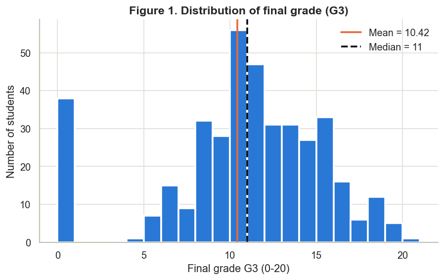
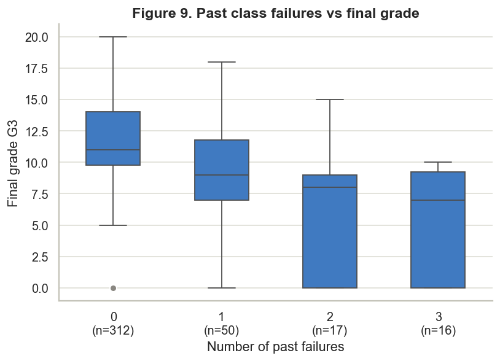
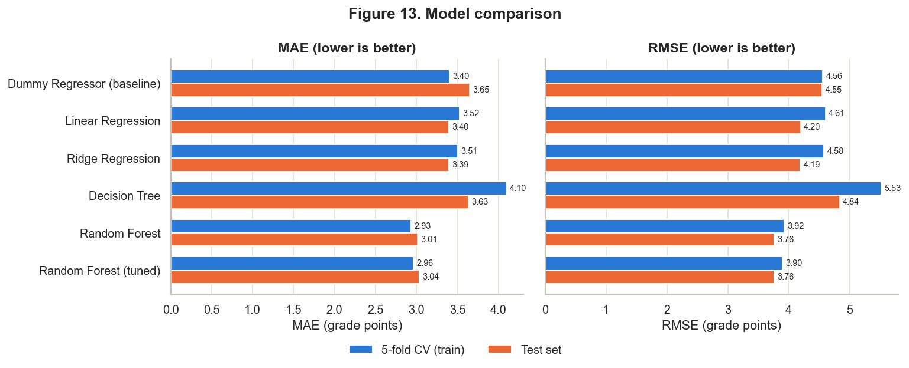
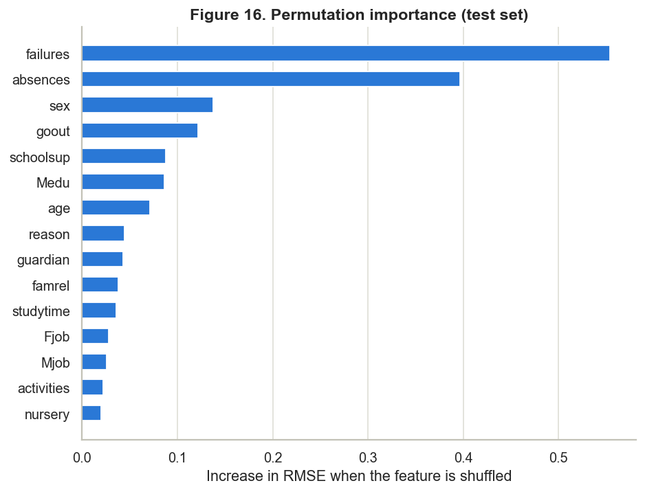

# 🎓 Student Performance Prediction Using Machine Learning

> **CSE570 – Machine Learning with Python** · End-to-end regression project · Python, scikit-learn, Streamlit

Predict a student's **final Mathematics grade (G3, 0–20)** from personal, family, school and lifestyle information – **without using the earlier exam grades G1 and G2** – and serve the model in a simple Streamlit web app.

| | |
|---|---|
| **Final model** | Random Forest Regressor (tuned with GridSearchCV) |
| **Test MAE / RMSE / R²** | **3.04 / 3.76 / 0.31** (baseline: 3.65 / 4.55 / −0.01) |
| **Dataset** | UCI Student Performance – `student-mat.csv` (395 students, 33 columns) |
| **Report** | [reports/project_report.md](reports/project_report.md) |
| **Notebook** | [notebooks/student_performance_analysis.ipynb](notebooks/student_performance_analysis.ipynb) |
| **Viva preparation** | [VIVA_QUESTIONS.md](VIVA_QUESTIONS.md) |

---

## 1. Problem statement
Schools want to identify students who may need extra academic support **before** final results are known. This project uses machine learning to estimate a student's final grade (G3) from background and study-related information, so that students who are predicted to score low could be noticed earlier.

> ⚠️ This is an **academic demonstration**, not a validated system for making real educational decisions.

**Why G1 and G2 are excluded:** they are the 1st- and 2nd-period grades of the same course and correlate 0.80 and 0.90 with G3. With them, the task becomes almost trivial ("the final grade is about the same as the last grade") and the model is no longer useful early in the year. The primary model therefore uses only the 30 non-grade features.

## 2. Objectives
1. Load, audit and clean the official UCI dataset.
2. Explore the data with statistics, visualisations and hypothesis tests.
3. Identify relationships between study habits/background and final grades.
4. Train a baseline and at least three regression models with leakage-safe pipelines.
5. Compare models with MAE, MSE, RMSE and R² (cross-validation + held-out test set).
6. Tune the best model with GridSearchCV and save the full pipeline.
7. Build a Streamlit app for predictions and document everything.

**Success criteria:** the final model must beat the mean-predicting baseline on MAE **and** RMSE in both cross-validation and on the test set, without using G1/G2. ✅ Achieved (MAE −0.61, RMSE −0.79 vs baseline on the test set).

## 3. Dataset
- **Source:** UCI Machine Learning Repository – [Student Performance](https://archive.ics.uci.edu/dataset/320/student+performance) (CC BY 4.0)
- **Citation:** P. Cortez and A. Silva. *Using Data Mining to Predict Secondary School Student Performance.* Proc. 5th FUture BUsiness TEChnology Conference (FUBUTEC 2008), pp. 5–12, Porto, Portugal, 2008.
- **File used:** `data/raw/student-mat.csv` (semicolon-separated) – 395 rows × 33 columns, **0 missing values, 0 duplicates**
- **Target:** `G3` – final grade 0–20 (mean 10.42, median 11, std 4.58; 38 students have G3 = 0)
- **Features (30):** 13 numeric/ordinal + 17 categorical/binary – full data dictionary in [data/raw/student_dataset_description.txt](data/raw/student_dataset_description.txt) and in the [report](reports/project_report.md#4-dataset-description)

**How to get the data** (already included in `data/raw/`): download the zip from the UCI page above, extract `student.zip`, and copy `student-mat.csv` into `data/raw/`.

## 4. Technology stack
Python 3.10 · Pandas · NumPy · Matplotlib · Seaborn · SciPy · scikit-learn · Joblib · Streamlit · pytest · Jupyter · Git/GitHub

## 5. Project structure
```
student-performance-prediction/
├── data/
│   ├── raw/                      # official UCI files (student-mat.csv + data dictionary)
│   └── processed/                # cleaned CSV (generated, not committed)
├── notebooks/
│   └── student_performance_analysis.ipynb   # full walkthrough with outputs
├── src/
│   ├── data_preprocessing.py     # load, audit, clean, feature lists, ColumnTransformer, split
│   ├── exploratory_analysis.py   # 12 EDA figures + statistical tests -> reports/eda_results.json
│   ├── train_model.py            # 5 models, CV, GridSearchCV, evaluation, plots, save model
│   ├── predict.py                # load model, validate input, predict one student
│   └── classification_extension.py  # optional pass/fail classification (Unit IV)
├── models/
│   ├── best_model.joblib         # complete preprocessing + Random Forest pipeline
│   └── model_metrics.json        # metrics read by the app
├── reports/
│   ├── figures/                  # all 19 figures (PNG)
│   ├── project_report.md         # academic report
│   ├── eda_results.json, model_comparison.csv, classification_results.json
├── tests/                        # pytest: preprocessing, prediction, app smoke test
├── app.py                        # Streamlit application
├── VIVA_QUESTIONS.md
├── requirements.txt
└── LICENSE
```

## 6. Installation (Windows)
```powershell
git clone https://github.com/karthik3344411/student-performance-prediction.git
cd student-performance-prediction
python -m venv .venv
.\.venv\Scripts\activate
pip install -r requirements.txt
```
(macOS/Linux: `source .venv/bin/activate`)

## 7. How to run
```powershell
python -m src.data_preprocessing        # Phase 1-2: audit + clean (prints a data overview)
python -m src.exploratory_analysis      # Phase 3: figures + statistical tests
python -m src.train_model               # Phase 4-7: train, compare, tune, save model (~1 min)
python -m src.classification_extension  # optional pass/fail experiment
streamlit run app.py                    # open http://localhost:8501
python -m pytest                        # run all tests (21 tests)
```
The notebook can be opened with `jupyter notebook notebooks/student_performance_analysis.ipynb`.

## 8. Results

### Model comparison (test set = 79 students; CV = 5-fold on the 316 training students)
| Model | Test MAE | Test RMSE | Test R² | CV MAE | CV RMSE | CV R² |
|---|---|---|---|---|---|---|
| Dummy Regressor (baseline) | 3.646 | 4.550 | −0.010 | 3.403 | 4.563 | −0.035 |
| Linear Regression | 3.395 | 4.196 | 0.141 | 3.523 | 4.607 | −0.092 |
| Ridge Regression | 3.393 | 4.193 | 0.142 | 3.506 | 4.584 | −0.080 |
| Decision Tree | 3.633 | 4.838 | −0.141 | 4.102 | 5.527 | −0.570 |
| Random Forest | **3.010** | 3.765 | 0.309 | **2.934** | 3.925 | 0.212 |
| **Random Forest (tuned) – final** | 3.035 | **3.761** | **0.310** | 2.960 | **3.897** | **0.232** |

Best hyperparameters: `n_estimators=200, max_features=0.5, max_depth=None, min_samples_leaf=1`.

### Key observations
- **Past failures** is the strongest single signal (mean G3: 11.3 with 0 failures → 5.7 with 3+; Kruskal–Wallis p < 0.001).
- **All 38 students with G3 = 0 have 0 absences** – they most likely left the course or missed the exam. Excluding them, absences correlate negatively with G3 (Spearman ρ = −0.24, p < 0.001).
- Random Forest clearly beats the linear models and the baseline; a single unpruned Decision Tree **overfits** (train RMSE 0, CV RMSE 5.53).
- Tuning gave only a small CV improvement (RMSE 3.93 → 3.90); test performance is practically unchanged.
- Without G1/G2 the model explains about **31 %** of the variance. Typical error is ~3 grade points – useful as a rough risk signal, not as an exact grade.
- The model struggles most with the G3 = 0 students (MAE 8.06 on them vs 2.70 for others).

| | |
|---|---|
|  |  |
|  |  |

### Optional extension – pass/fail classification (G3 ≥ 10)
Logistic Regression was chosen by CV macro-F1 (0.65); on the test set: accuracy 0.60, recall for *fail* 0.46, ROC-AUC 0.60. The "always pass" baseline has higher accuracy (0.67) but finds **no** failing students – a good example of why accuracy alone is misleading on imbalanced data.

## 9. Streamlit app
Form with all 30 model inputs (grouped into Personal / Family / School & study / Lifestyle) → predicted G3, grade band, typical error range and the most influential features. A second tab shows model metrics and plots. The app shows a clear error if `models/best_model.joblib` is missing, validates inputs, and shows the raw model output if it ever had to be limited to 0–20.

## 10. Limitations
- Small dataset (395 students; only 79 in the test set) from two schools in Portugal, one subject → results may not generalise.
- Survey answers are self-reported; some features are sensitive (e.g. alcohol, romantic relationship).
- The G3 = 0 group (probable dropouts) behaves differently and causes the largest errors.
- Moderate accuracy (R² ≈ 0.31): background information alone cannot predict grades precisely.
- Associations found in EDA are **not causal**.

## 11. Future improvements
- Treat G3 = 0 separately (a dropout classifier + a grade regressor for the rest).
- Combine Maths and Portuguese datasets (`student-por.csv`) for more data.
- Try gradient boosting and SHAP explanations; repeated cross-validation for more stable estimates.
- Fairness check of predictions across gender/address groups before any real use.

## 12. Evidence links
- GitHub repository: https://github.com/karthik3344411/student-performance-prediction
- LinkedIn post: _add link after publishing_

## 13. License
Code: MIT (see [LICENSE](LICENSE)). Dataset: UCI Machine Learning Repository, CC BY 4.0.
