

Lovely Professional University

CSE570 – Machine Learning with Python Academic Task 2 · Skill Based Assignment

<h1 class="main-title">Student Performance Prediction Using Machine Learning</h1>

An End-to-End Machine Learning Solution for a Real-World Problem

| | |
|---|---|
| **Student name** | Dondla Karthik |
| **Registration number** | 12625778 |
| **Roll number** | 37 |
| **Section** | K3P26DS |
| **Course code / title** | CSE570 – Machine Learning with Python |
| **GitHub repository** | https://github.com/karthik3344411/student-performance-prediction |
| **Live web app** | https://student-performance-karthik.streamlit.app |
| **Date of submission** | 12 November 2026 |

## Table of Contents
1. Title Page
2. [Abstract](#2-abstract)
3. [Introduction & Problem Statement](#3-introduction-problem-statement)
4. [Dataset Description](#4-dataset-description)
5. [Data Preprocessing](#5-data-preprocessing)
6. [Exploratory Data Analysis (EDA)](#6-exploratory-data-analysis-eda)
7. [Methodology](#7-methodology)
8. [Model Development](#8-model-development)
9. [Results & Model Comparison](#9-results-model-comparison)
10. [Conclusion & Limitations](#10-conclusion-limitations)
11. [References](#11-references)
12. [GitHub & LinkedIn Evidence](#12-github-linkedin-evidence)

## 2. Abstract
This project builds an end-to-end machine-learning system that estimates a secondary-school student's final Mathematics grade (G3, scale 0–20) from 30 demographic, family, school and lifestyle attributes of the UCI *Student Performance* dataset (395 students). Earlier period grades (G1, G2) are deliberately excluded so that the model shows what can be predicted from background information alone. After the data was audited and cleaned, exploratory analysis with hypothesis tests showed that past class failures are the strongest single correlate of the final grade (Spearman ρ = −0.36). It also revealed that all 38 students with G3 = 0 have zero recorded absences, which suggests they did not sit the final exam. Five regression pipelines (mean baseline, Linear, Ridge, Decision Tree and Random Forest) were compared with 5-fold cross-validation on the training set and evaluated once on a held-out test set. A Random Forest tuned with GridSearchCV performed best: test MAE 3.04, RMSE 3.76 and R² 0.31, compared with 3.65, 4.55 and −0.01 for the baseline. The final pipeline is saved with Joblib and served through a Streamlit web application. An optional pass/fail classification experiment is also reported. The results show that background data gives a useful but coarse estimate of performance, and that the largest errors come from students who probably dropped out.

**Keywords:** educational data mining, regression, random forest, cross-validation, scikit-learn pipeline, Streamlit

## 3. Introduction & Problem Statement

### 3.1 Introduction
Academic performance in core subjects such as Mathematics strongly affects students' future options. If a school can recognise students who are likely to struggle early, teachers can offer tutoring, counselling or other support before the final exam. Machine learning can learn patterns from historical records, for example that students with previous failures tend to score lower, and apply them to new students. This report documents the complete workflow, from problem definition to a deployed web application. Every number in it was produced by the code in the GitHub repository; nothing was entered by hand.

### 3.2 Problem statement

| Item | Description |
|---|---|
| **Context** | Portuguese secondary-school students (two schools) taking Mathematics. Teachers need an early indication of which students may perform poorly. |
| **Target variable** | `G3` – final Mathematics grade, an integer from 0 to 20 (≥ 10 is a pass). |
| **ML task** | **Supervised regression** (predict a numeric grade). An optional binary classification (pass/fail) is reported as an extension. |
| **Inputs** | 30 attributes covering demographics, family background, school, study habits and lifestyle. **G1 and G2 are excluded.** |
| **Success criteria** | (1) The final model beats a mean-predicting baseline on **both MAE and RMSE**, in cross-validation **and** on the held-out test set; (2) there is no data leakage (all preprocessing is fitted on training data only); (3) a working application returns a prediction in the valid range 0–20. |
| **Assumptions** | Historical records represent future students in the same schools; survey answers are reasonably truthful. |
| **Constraints** | Small dataset (395 rows); beginner-friendly, explainable methods; must run on a normal Windows laptop; academic demonstration only. |

**Why exclude G1 and G2?** They are the first- and second-period grades of the same course, and their Pearson correlations with G3 are 0.80 and 0.90 (Figure 10). Including them would give a high R² simply because "the final grade is close to the previous grade". Such a model would only be usable late in the school year and would hide which background factors matter.

### 3.3 Objectives
1. Load and audit the official UCI dataset (shape, data types, missing values, duplicates).
2. Clean and preprocess the data without data leakage (encoding, scaling, and a train/test split inside pipelines).
3. Perform univariate, bivariate and multivariate EDA with descriptive statistics and statistical tests.
4. Train a baseline and at least three regression models, and compare them with MAE, MSE, RMSE and R².
5. Tune the best model with GridSearchCV, using cross-validation on the training data only.
6. Interpret the final model (feature importance, residuals) and state its limitations.
7. Save the complete pipeline and build a Streamlit application for predictions.

### 3.4 Scope
- **In scope:** the Mathematics file (`student-mat.csv`); regression of G3 from 30 non-grade features; classical scikit-learn models; a Streamlit app (runs locally and is hosted publicly on Streamlit Community Cloud); an optional pass/fail classification experiment.
- **Out of scope:** the Portuguese-language file, deep learning, and any use for real decisions about students.

### 3.5 Applications
- **Early-warning support:** helping teachers and counsellors decide which students to check on first.
- **Resource planning:** estimating how many students may need tutoring in a class.
- **Education analytics:** understanding which background factors are associated with performance.
- **Teaching:** a complete, reproducible example of an ML workflow (pipelines, cross-validation, tuning, deployment).

## 4. Dataset Description

| Property | Value |
|---|---|
| Name | Student Performance (UCI Machine Learning Repository, ID 320) |
| Source | https://archive.ics.uci.edu/dataset/320/student+performance |
| Citation | Cortez, P. & Silva, A. (2008) [1], [2] |
| License | Creative Commons Attribution 4.0 (CC BY 4.0) |
| File used | `student-mat.csv` (Mathematics course), separator `;` |
| Size | **395 records × 33 columns** (30 input attributes + G1, G2, G3) |
| Feature types | 13 numeric (mostly ordinal scales) + 17 categorical (4 nominal multi-class, 13 binary) |
| Missing values / duplicates | **0 / 0** |
| Target variable | **G3** (0–20): mean 10.42, median 11, std 4.58, 95% CI of the mean [9.96, 10.87] |

### 4.1 Target (class) distribution

*Table 1. Distribution of the final grade G3 (n = 395).*

| G3 band | Students | Share |
|---|---|---|
| 0 (probably did not sit the exam) | 38 | 9.6% |
| 1–9 (fail) | 92 | 23.3% |
| 10–13 (pass) | 165 | 41.8% |
| 14–15 (good) | 60 | 15.2% |
| 16–20 (very good / excellent) | 40 | 10.1% |
| **Pass (G3 ≥ 10) / Fail (G3 < 10)** | **265 / 130** | **67.1% / 32.9%** |

For regression the target is the numeric grade. For the optional classification task the classes are moderately imbalanced (about 2 passes for every fail).

### 4.2 Data dictionary

*Table 2. Data dictionary (from the official UCI description).*

| # | Feature | Type | Description / values |
|---|---|---|---|
| 1 | school | binary | GP = Gabriel Pereira, MS = Mousinho da Silveira |
| 2 | sex | binary | F = female, M = male |
| 3 | age | numeric | 15–22 |
| 4 | address | binary | U = urban, R = rural |
| 5 | famsize | binary | LE3 = ≤ 3, GT3 = > 3 |
| 6 | Pstatus | binary | parents living together (T) or apart (A) |
| 7 | Medu | ordinal | mother's education: 0 none, 1 primary, 2 5th–9th grade, 3 secondary, 4 higher |
| 8 | Fedu | ordinal | father's education (same scale) |
| 9 | Mjob | nominal | mother's job: teacher, health, services, at_home, other |
| 10 | Fjob | nominal | father's job (same categories) |
| 11 | reason | nominal | reason for choosing the school: home, reputation, course, other |
| 12 | guardian | nominal | mother, father, other |
| 13 | traveltime | ordinal | 1 < 15 min, 2 15–30 min, 3 30–60 min, 4 > 1 h |
| 14 | studytime | ordinal | weekly study: 1 < 2 h, 2 2–5 h, 3 5–10 h, 4 > 10 h |
| 15 | failures | numeric | past class failures (0–3; 3 means 3 or more) |
| 16 | schoolsup | binary | extra educational support from school |
| 17 | famsup | binary | family educational support |
| 18 | paid | binary | extra paid classes in the subject |
| 19 | activities | binary | extra-curricular activities |
| 20 | nursery | binary | attended nursery school |
| 21 | higher | binary | wants to take higher education |
| 22 | internet | binary | internet access at home |
| 23 | romantic | binary | in a romantic relationship |
| 24 | famrel | ordinal | quality of family relationships, 1 (very bad) – 5 (excellent) |
| 25 | freetime | ordinal | free time after school, 1–5 |
| 26 | goout | ordinal | going out with friends, 1–5 |
| 27 | Dalc | ordinal | workday alcohol consumption, 1–5 |
| 28 | Walc | ordinal | weekend alcohol consumption, 1–5 |
| 29 | health | ordinal | current health status, 1–5 |
| 30 | absences | numeric | number of school absences (0–93; observed maximum 75) |
| 31 | G1 | numeric | first-period grade, 0–20 – **not used as an input** |
| 32 | G2 | numeric | second-period grade, 0–20 – **not used as an input** |
| 33 | **G3** | numeric | **final grade, 0–20 – target** |

### 4.3 Why this dataset is appropriate
- It is a well-documented, peer-reviewed public dataset that matches the problem exactly: real student records with a real final grade.
- It mixes numeric, ordinal, binary and nominal features, so it exercises every preprocessing step taught in the course.
- It has no missing values, yet it contains real data-quality issues (skewed absences, a group of zero grades) to investigate.
- At 395 rows it trains in seconds on a laptop, but it is small enough that careful validation really matters.

## 5. Data Preprocessing

*Table 3. Cleaning and preprocessing steps.*

| Step | Finding | Action |
|---|---|---|
| Loading | The file is `;`-separated and grade values are quoted (`"5"`) | `pd.read_csv(sep=";")`; pandas parses the quoted grades as integers |
| Data types | 16 numeric and 17 text columns, all as documented | `pd.to_numeric` on numeric columns (as a safety check); spaces stripped from text columns |
| Missing values | 0 | None needed. The code still fills numeric columns with the median and text columns with the mode, and never fills the target |
| Duplicates | 0 exact duplicates | `drop_duplicates()` (no rows removed) |
| Range validation | Every value lies inside its official range | `clean_data()` raises an error if any value is out of range |
| Outliers (IQR rule) | `absences`: 15 values > 20 (max 75); `age`: one 22-year-old; `failures`: 83 flagged only because 79% of students have 0 | **Kept.** They are plausible, real observations, and tree models are robust to them |
| G3 = 0 | 38 students (9.6%) | **Kept** as real outcomes; analysed in Section 6.4 |
| Feature selection | G1 and G2 are strongly correlated with G3 | Excluded from the inputs (Section 3.2) |
| Encoding | 17 categorical columns | `OneHotEncoder(handle_unknown="ignore")`: the 30 inputs become 56 model columns |
| Scaling | 13 numeric columns on different scales (absences 0–75 vs. 1–5 scales) | `StandardScaler` (needed for Linear/Ridge, harmless for trees) |
| Train/test split | — | 80% train (316) / 20% test (79), `random_state = 42` |

**Leakage prevention.** The scaler and encoder sit inside a scikit-learn `Pipeline` together with the model, so they learn means, standard deviations and categories **only from training data**, including within each cross-validation fold. A unit test checks that the fitted scaler's means equal the training-set means.

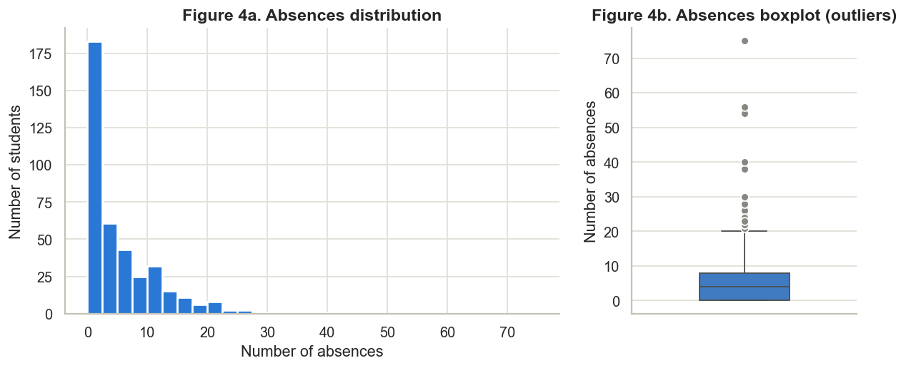

*Figure 4. Absences are strongly right-skewed (median 4, mean 5.7, maximum 75); the boxplot marks 15 high values as IQR outliers.*

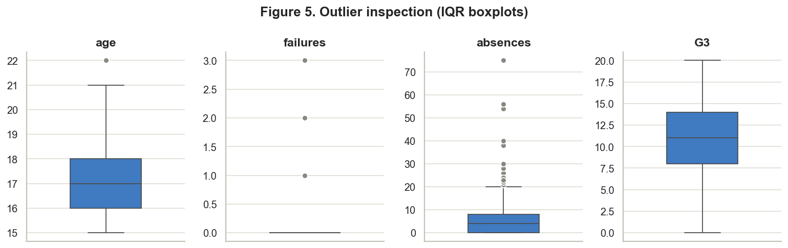

*Figure 5. Outlier inspection with IQR boxplots. No values fall outside the documented ranges.*

## 6. Exploratory Data Analysis (EDA)

### 6.1 Descriptive statistics

*Table 4. Descriptive statistics of the numeric variables (n = 395).*

| Variable | Mean | Median | Std | Min | Max |
|---|---|---|---|---|---|
| age | 16.70 | 17 | 1.28 | 15 | 22 |
| Medu | 2.75 | 3 | 1.09 | 0 | 4 |
| Fedu | 2.52 | 2 | 1.09 | 0 | 4 |
| traveltime | 1.45 | 1 | 0.70 | 1 | 4 |
| studytime | 2.04 | 2 | 0.84 | 1 | 4 |
| failures | 0.33 | 0 | 0.74 | 0 | 3 |
| famrel | 3.94 | 4 | 0.90 | 1 | 5 |
| freetime | 3.24 | 3 | 1.00 | 1 | 5 |
| goout | 3.11 | 3 | 1.11 | 1 | 5 |
| Dalc | 1.48 | 1 | 0.89 | 1 | 5 |
| Walc | 2.29 | 2 | 1.29 | 1 | 5 |
| health | 3.55 | 4 | 1.39 | 1 | 5 |
| absences | 5.71 | 4 | 8.00 | 0 | 75 |
| G1 | 10.91 | 11 | 3.32 | 3 | 19 |
| G2 | 10.71 | 11 | 3.76 | 0 | 19 |
| **G3** | **10.42** | **11** | **4.58** | **0** | **20** |

### 6.2 Univariate analysis

*Figure 1. Distribution of the final grade G3: mean 10.42 (95% CI 9.96–10.87), median 11.*

Most grades lie between 8 and 15, with a separate spike at 0 (38 students). Because of this spike the distribution is not normal (Shapiro–Wilk W = 0.93, p < 0.001), so non-parametric tests are reported alongside parametric ones.

| 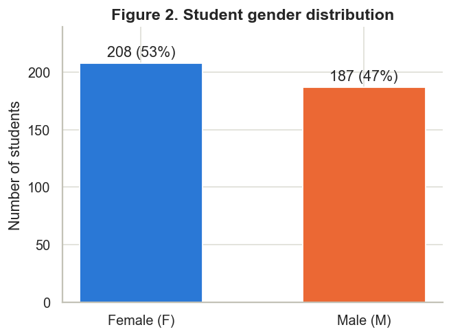 | 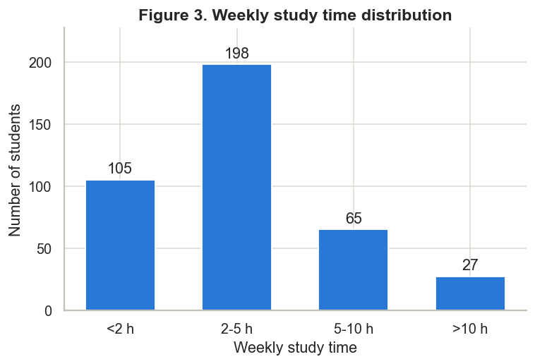 |
|---|---|
| *Figure 2. 208 female (53%) and 187 male (47%) students: a balanced sample.* | *Figure 3. Most students study 2–5 h per week (198); only 27 study more than 10 h.* |

### 6.3 Bivariate analysis and statistical tests

*Figure 9. Final grade by number of past failures.*

**Failures:** mean G3 falls from 11.25 (0 failures, n = 312) to 8.12 (1, n = 50), 6.24 (2, n = 17) and 5.69 (3+, n = 16). Kruskal–Wallis H = 53.1, **p < 0.001**. This is the strongest relationship in the data.

| 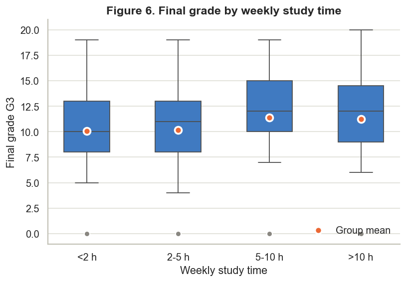 | 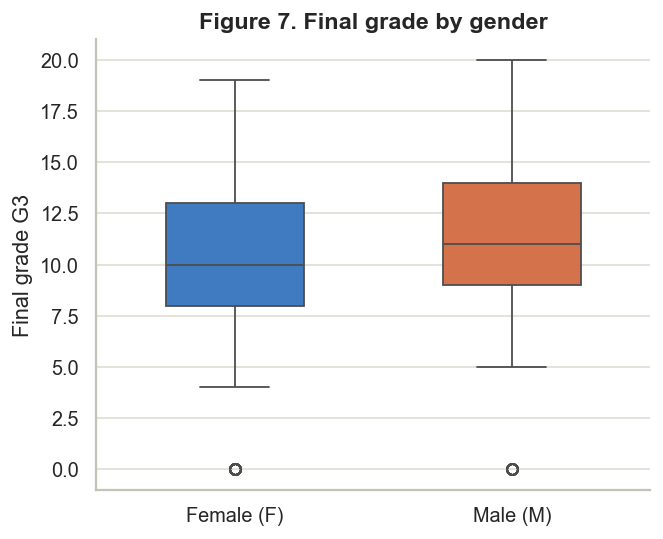 |
|---|---|
| *Figure 6. G3 by weekly study time (orange dots = group means).* | *Figure 7. G3 by gender.* |

- **Study time:** the group means are 10.05, 10.17, 11.40 and 11.26 for < 2, 2–5, 5–10 and > 10 h. The trend is upward but **not statistically significant** at α = 0.05 (one-way ANOVA F = 1.73, p = 0.161; Kruskal–Wallis p = 0.056).
- **Gender:** male students average 10.91 and female students 9.97 (Welch t = −2.07, **p = 0.040**). The difference is small, about one grade point.
- **Higher education vs passing:** the pass rate is 68.8% for students who want higher education (n = 375) and 35.0% for those who do not (n = 20); chi-square = 8.35, df = 1, **p = 0.004**. Only 20 students answered "no", so this estimate is uncertain.

*Table 5. Correlation of numeric inputs with G3 (n = 395).*

| Feature | Spearman ρ | p-value | Pearson r |
|---|---|---|---|
| failures | −0.361 | < 0.001 | −0.360 |
| Medu | +0.225 | < 0.001 | +0.217 |
| age | −0.173 | < 0.001 | −0.162 |
| Fedu | +0.170 | < 0.001 | +0.152 |
| goout | −0.166 | < 0.001 | −0.133 |
| Dalc | −0.121 | 0.016 | −0.055 |
| traveltime | −0.121 | 0.017 | −0.117 |
| studytime | +0.105 | 0.037 | +0.098 |
| Walc | −0.104 | 0.038 | −0.052 |
| famrel | +0.055 | 0.276 | +0.051 |
| health | −0.048 | 0.343 | −0.061 |
| absences | +0.018 | 0.725 | +0.034 |
| freetime | −0.005 | 0.921 | +0.011 |

*Table 6. Group comparison: mean G3 (n) by selected categories.*

| Feature | Group A | Group B |
|---|---|---|
| higher | yes: 10.61 (375) | no: 6.80 (20) |
| address | urban: 10.67 (307) | rural: 9.51 (88) |
| internet | yes: 10.62 (329) | no: 9.41 (66) |
| romantic | no: 10.84 (263) | yes: 9.58 (132) |
| schoolsup | no: 10.56 (344) | yes: 9.43 (51) |
| paid | yes: 10.92 (181) | no: 9.99 (214) |
| school | GP: 10.49 (349) | MS: 9.85 (46) |

Students who receive extra school support have *lower* average grades. This is most likely because support goes to students who were already struggling, a reminder that **correlation does not imply causation**.

### 6.4 Key finding: the G3 = 0 group and absences

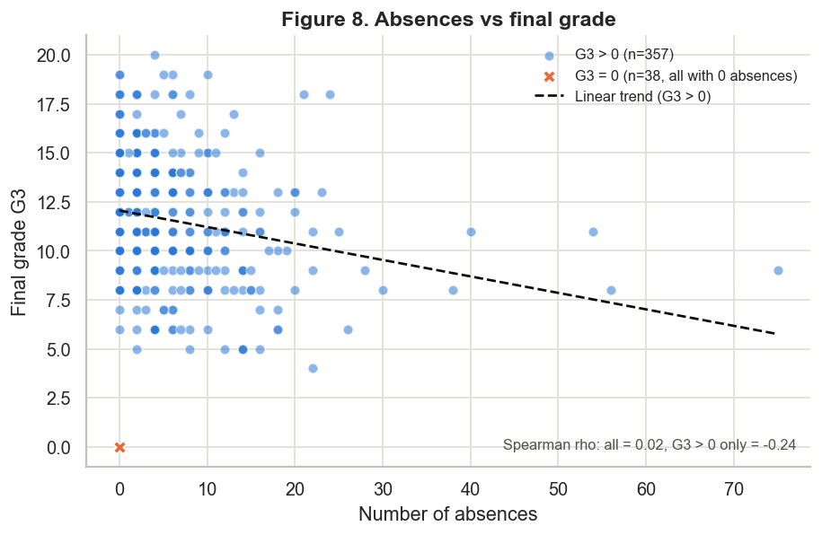

*Figure 8. Absences vs final grade. Orange crosses mark the 38 students with G3 = 0.*

Across all students, absences appear unrelated to G3 (ρ = 0.02, p = 0.73). However, **all 38 students with G3 = 0 have exactly 0 recorded absences**, compared with only 21.6% of the other students. Twenty-five of them had a non-zero second-period grade, and they average 0.92 past failures against 0.27 for the rest. The most plausible explanation is that these students left the course or did not sit the final exam. **Excluding them, absences correlate negatively with G3 (ρ = −0.24, p < 0.001)**, the expected direction. This hidden pattern also explains why the Random Forest later ranks `absences` as highly important.

### 6.5 Multivariate analysis

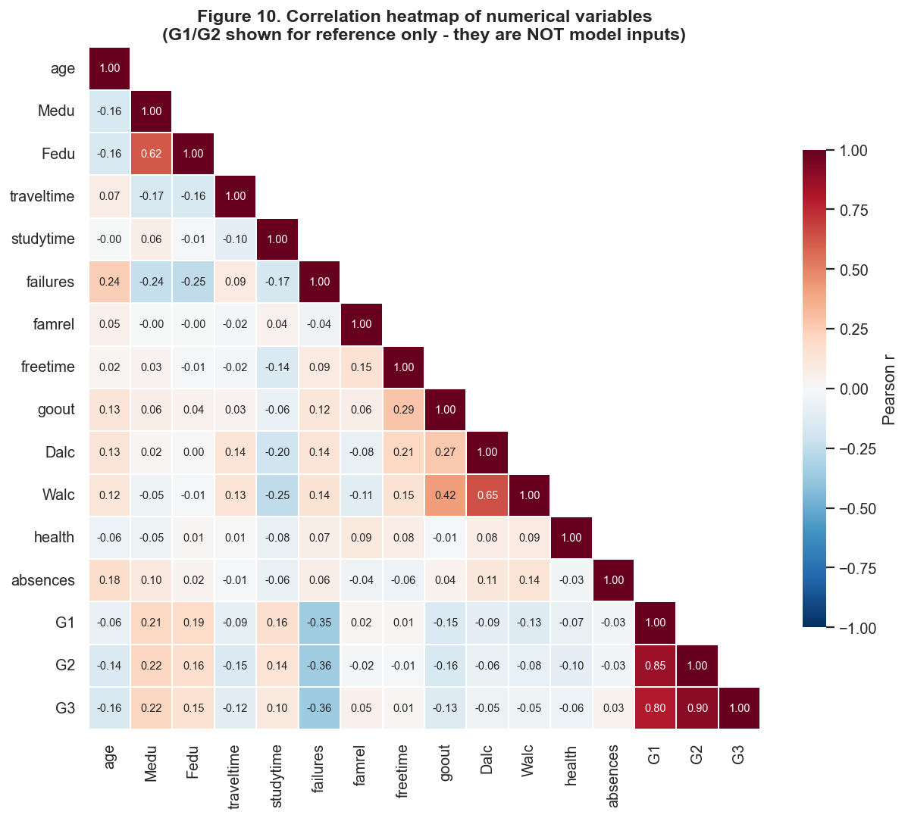

*Figure 10. Pearson correlation heatmap of the numeric variables (G1/G2 shown for reference only).*

G1, G2 and G3 are very strongly inter-correlated (0.80–0.90), which justifies excluding G1 and G2. Among the inputs there are correlated pairs: Medu–Fedu (0.62), Dalc–Walc (0.65) and goout–Walc (0.42). This multicollinearity makes individual Linear Regression coefficients unstable, which is one reason Ridge Regression was also tested.

| 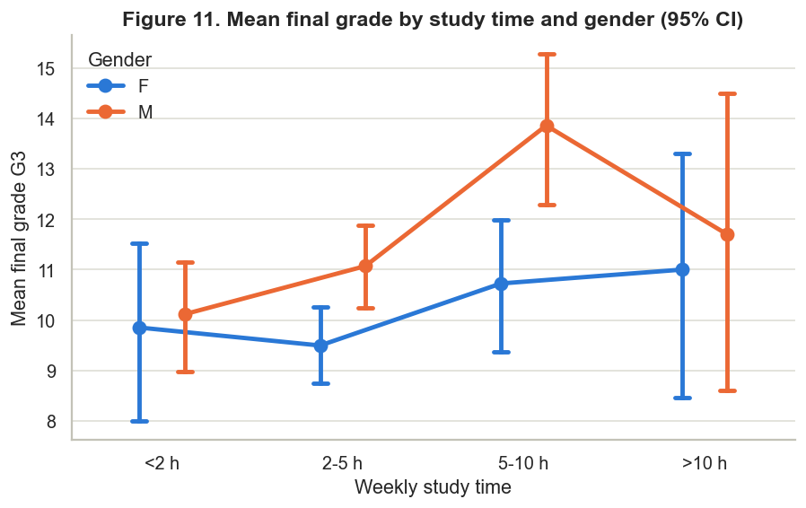 | 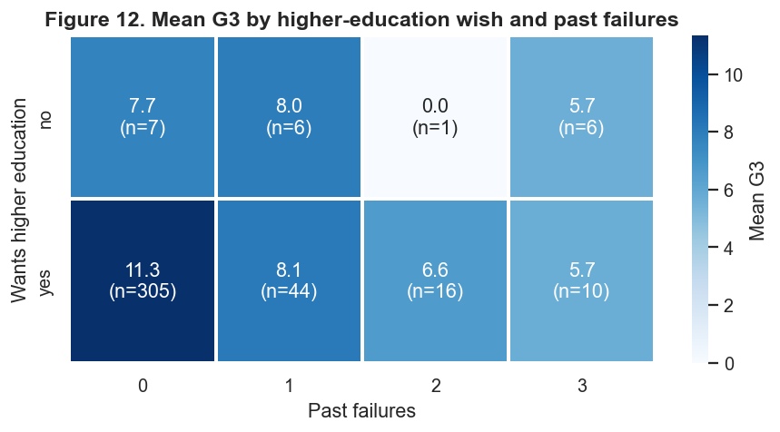 |
|---|---|
| *Figure 11. Mean G3 by study time and gender, with 95% CIs.* | *Figure 12. Mean G3 by higher-education wish and past failures.* |

In Figure 11 the confidence intervals overlap widely, so the gender and study-time effects are small and uncertain. Figure 12 shows that failures lower the mean grade in both groups; the best combination (wants higher education, no failures, n = 305) averages 11.3.

### 6.6 Key observations
1. Past failures are the clearest signal of a low final grade.
2. Mother's education, wish for higher education, going out, age, and absences (among students who sat the exam) carry weaker signals.
3. Study time, family relationships, free time and health show little or no relationship with G3.
4. The 38 zero grades form a separate group (probable dropouts) that distorts simple statistics.
5. All of these are associations, not causes.

## 7. Methodology

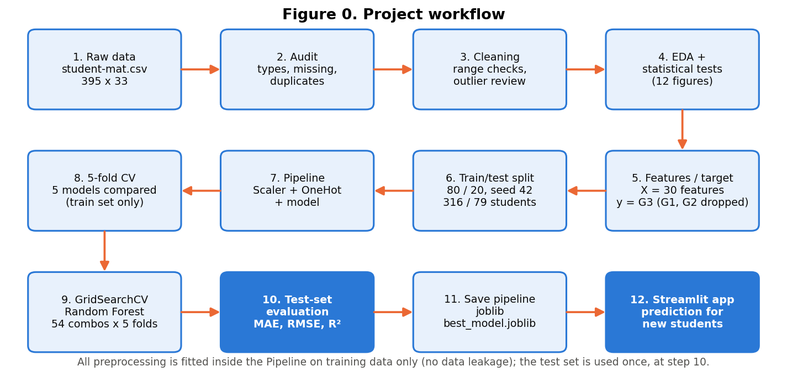

*Figure 0. Complete machine-learning workflow followed in this project.*

1. **Data acquisition:** download the official UCI file and load it with pandas.
2. **Audit and cleaning:** check data types, missing values, duplicates, value ranges and outliers (Section 5).
3. **EDA:** run univariate, bivariate and multivariate analysis with statistical tests (Section 6).
4. **Feature/target definition:** use 30 input features and set G3 as the target; G1 and G2 are dropped.
5. **Train/test split:** 316 training and 79 test students (`random_state = 42`).
6. **Pipeline:** a `ColumnTransformer` (`StandardScaler` + `OneHotEncoder`) followed by the model, so no data leaks from validation or test data into preprocessing.
7. **Model comparison:** 5-fold cross-validation on the training set only; models are ranked by CV RMSE and CV MAE together.
8. **Tuning:** `GridSearchCV` on the best model, again using training data only.
9. **Final evaluation:** each model is evaluated **once** on the untouched test set.
10. **Interpretation:** residual analysis, plus permutation and impurity feature importance.
11. **Deployment:** the whole pipeline is saved with `joblib`, and a Streamlit app loads it for predictions. The app is hosted on Streamlit Community Cloud at https://student-performance-karthik.streamlit.app (Section 12.2).

**Why cross-validation?** With only 79 test students, a single split is noisy and can rank models by chance (Section 9.3 shows a real example). Making every decision with 5-fold CV and touching the test set only once gives an honest final estimate.

**Software:** Python 3.10, pandas 2.3, NumPy 2.2, scikit-learn 1.7, SciPy 1.15, Matplotlib 3.10, Seaborn 0.13, Joblib 1.6, Streamlit 1.65 and pytest 9.2 (21 automated tests).

## 8. Model Development

All models share the same preprocessing pipeline.

*Table 7. Models trained.*

| Model | Why it was included | Initial settings |
|---|---|---|
| **Dummy Regressor (baseline)** | Always predicts the training mean (≈ 10.4); any useful model must beat it | `strategy="mean"` |
| **Linear Regression** | Simple, interpretable linear model | default |
| **Ridge Regression** | Linear model with L2 regularisation; handles correlated inputs | `alpha=1.0` |
| **Decision Tree Regressor** | Non-linear, captures interactions, easy to visualise | `random_state=42`, no depth limit |
| **Random Forest Regressor** | Ensemble of trees that reduces the overfitting of a single tree | `n_estimators=300`, `random_state=42` |

**Training and selection.** Each pipeline was scored with 5-fold CV (MAE, RMSE, R²) on the 316 training students. The non-baseline models were ranked by CV RMSE and CV MAE, and **Random Forest** ranked first on both. R² was not used on its own, because MAE and RMSE are in grade points and are easier to explain to teachers.

**Hyperparameter tuning.** `GridSearchCV` (5-fold CV on the training set, scored by RMSE) searched 2 × 3 × 3 × 3 = **54 combinations** (270 model fits):

*Table 8. Random Forest hyperparameter grid.*

| Hyperparameter | Values tried | Meaning | Best |
|---|---|---|---|
| `n_estimators` | 200, 500 | number of trees | **200** |
| `max_depth` | None, 6, 10 | maximum depth of each tree | **None** |
| `min_samples_leaf` | 1, 3, 5 | minimum number of students in a leaf | **1** |
| `max_features` | 1.0, 0.5, "sqrt" | share of features considered at each split | **0.5** |

Tuning tested whether limiting tree depth or sampling features reduces overfitting. The best setting uses half of the features at each split, which makes the trees more diverse. The tuned model replaced the default because its **CV** RMSE was lower (3.897 vs 3.925); the test set played no part in that choice. The final pipeline is saved as `models/best_model.joblib` (4.3 MB), with its metrics in `models/model_metrics.json`.

## 9. Results & Model Comparison

### 9.1 Evaluation metrics
- **MAE** – mean absolute error: the average number of grade points by which a prediction is off.
- **MSE** – mean squared error: penalises large errors more heavily.
- **RMSE** – the square root of MSE, in grade points.
- **R²** – the share of the variance in G3 explained by the model (0 = no better than predicting the mean; negative = worse than the mean).

### 9.2 Final model performance

*Table 9. Final model vs baseline on the held-out test set (79 students).*

| Metric | Baseline | Final model (tuned Random Forest) | Improvement |
|---|---|---|---|
| MAE | 3.646 | **3.035** | −0.61 (−17%) |
| MSE | 20.704 | **14.145** | −6.56 (−32%) |
| RMSE | 4.550 | **3.761** | −0.79 (−17%) |
| R² | −0.010 | **0.310** | +0.32 |

### 9.3 Model comparison

*Table 10. All models: test set (79 students) and 5-fold cross-validation on the training set (316 students).*

| Model | Test MAE | Test MSE | Test RMSE | Test R² | CV MAE | CV RMSE | CV R² | Train RMSE |
|---|---|---|---|---|---|---|---|---|
| Dummy (baseline) | 3.646 | 20.704 | 4.550 | −0.010 | 3.403 | 4.563 | −0.035 | 4.583 |
| Linear Regression | 3.395 | 17.604 | 4.196 | 0.141 | 3.523 | 4.607 | −0.092 | 3.865 |
| Ridge Regression | 3.393 | 17.585 | 4.193 | 0.142 | 3.506 | 4.584 | −0.080 | 3.865 |
| Decision Tree | 3.633 | 23.405 | 4.838 | −0.141 | 4.102 | 5.527 | −0.570 | 0.000 |
| Random Forest | **3.010** | 14.175 | 3.765 | 0.309 | **2.934** | 3.925 | 0.212 | 1.457 |
| **RF (tuned) – final** | 3.035 | **14.145** | **3.761** | **0.310** | 2.960 | **3.897** | **0.232** | 1.451 |

*Figure 13. MAE and RMSE for every model (blue = 5-fold CV, orange = test set).*

- **Linear and Ridge Regression:** both beat the baseline on the test set (R² 0.14) but are *worse* than the baseline in cross-validation (CV R² < 0). A single split can mislead, which is why the models were selected with CV.
- **Decision Tree:** its training RMSE is 0.00 but its CV RMSE is 5.53, a textbook case of **overfitting** in which the tree memorises the training students.
- **Random Forest:** averaging many decorrelated trees greatly reduces this variance. It is the best model in CV and on the test set, and it captures non-linear patterns that linear models miss.
- **Tuned vs default Random Forest:** tuning gave only a small improvement (CV RMSE 3.925 → 3.897; test RMSE 3.765 → 3.761, with test MAE slightly worse at 3.010 → 3.035). The two are practically equivalent; the tuned version was kept according to the pre-defined CV rule.
- **Justification:** the tuned Random Forest has the lowest CV RMSE and the best test RMSE, MSE and R². It beats the baseline by 17% on both MAE and RMSE, which meets the success criterion.

### 9.4 Model behaviour

| 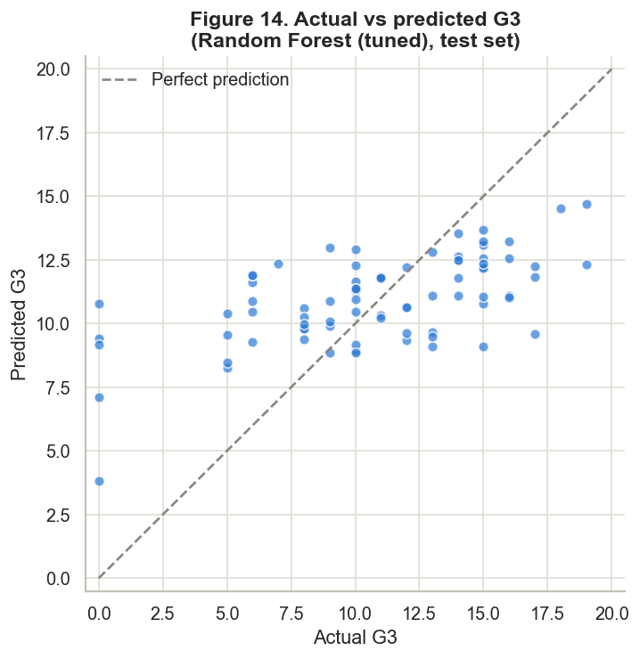 | 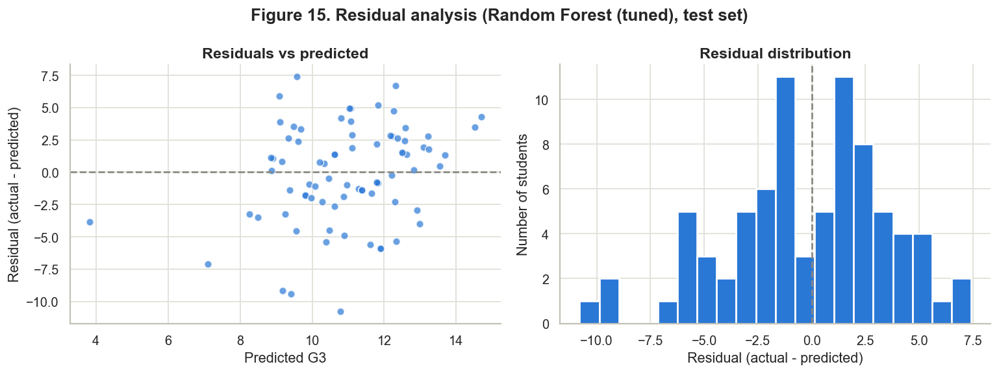 |
|---|---|
| *Figure 14. Actual vs predicted G3 (test set).* | *Figure 15. Residuals vs predictions and the residual distribution.* |

- The predictions are compressed towards the centre (about 8–14); the model avoids extreme values.
- The residuals are centred near zero (mean −0.18). 43% of predictions are within ±2 points and 73% within ±4 points.
- The five test students with G3 = 0 produce the largest errors (**MAE 8.06**, against **2.70** for the other 74 students).

|  | 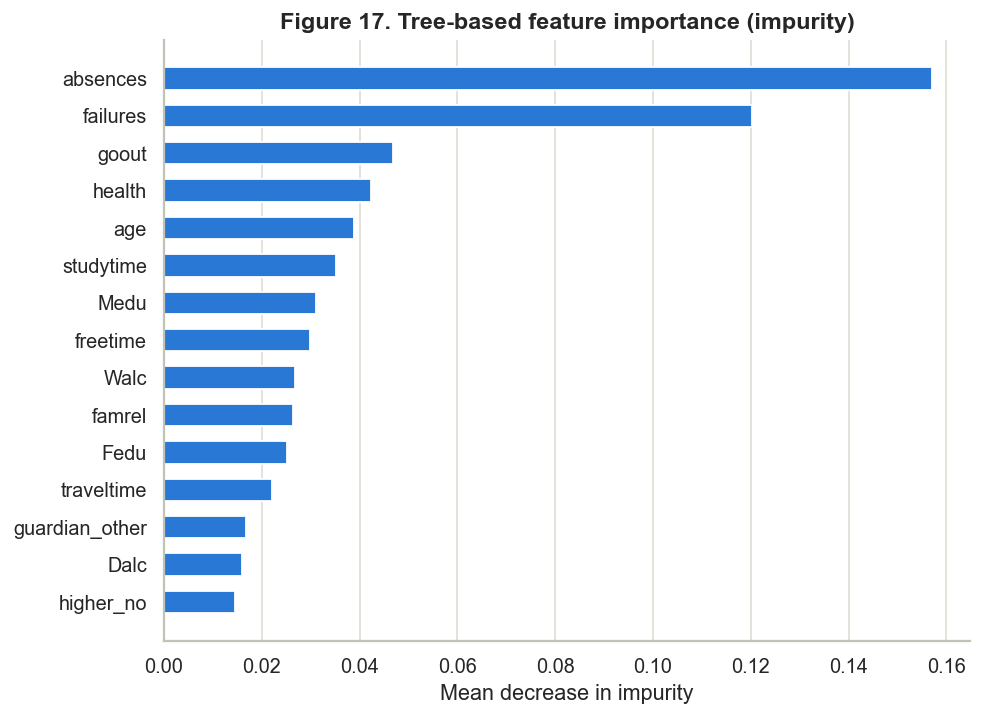 |
|---|---|
| *Figure 16. Permutation importance on the test set (increase in RMSE when a feature is shuffled).* | *Figure 17. Random Forest impurity-based importance.* |

Both methods agree that **failures** and **absences** dominate, followed by going out, gender, school support, mother's education and age. As a cross-check, the standardised Linear Regression coefficients show the same directions: failures −1.36 points per standard deviation, wanting higher education +0.88, male +0.75, study time +0.63.

### 9.5 Optional extension: pass/fail classification
The target was converted to **pass (G3 ≥ 10) / fail** (67.1% pass), keeping the same features and pipeline, with a stratified 80/20 split and class-balanced models.

*Table 11. Pass/fail classification on the test set (precision, recall and F1 are for the "fail" class).*

| Model | CV macro-F1 | Accuracy | Precision | Recall | F1 | Macro-F1 | ROC-AUC |
|---|---|---|---|---|---|---|---|
| Dummy (always "pass") | 0.402 | **0.671** | 0.000 | 0.000 | 0.000 | 0.402 | 0.500 |
| **Logistic Regression** | **0.652** | 0.595 | 0.400 | **0.462** | **0.429** | 0.557 | 0.595 |
| Decision Tree (depth 4) | 0.568 | 0.519 | 0.333 | 0.462 | 0.387 | 0.496 | 0.466 |
| Random Forest | 0.591 | 0.684 | **0.529** | 0.346 | 0.419 | **0.601** | **0.652** |

| 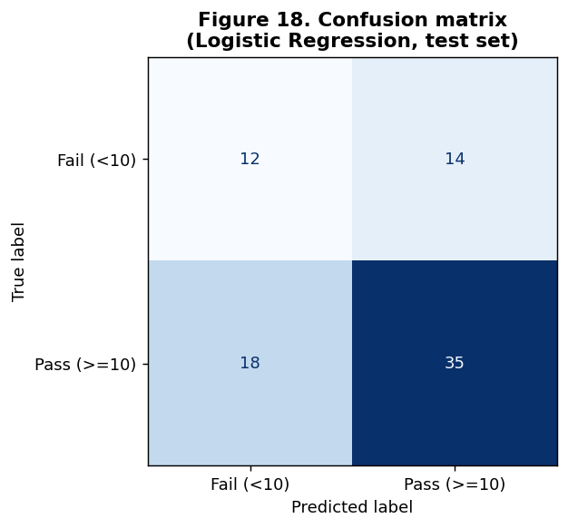 | 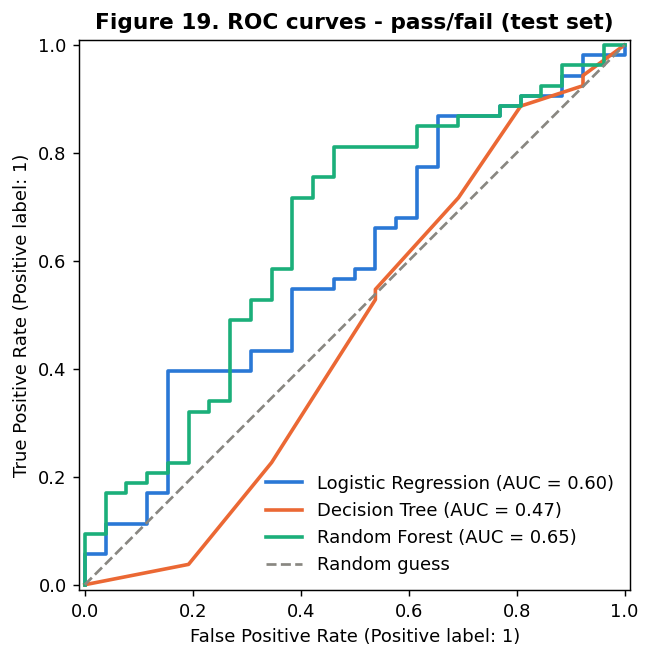 |
|---|---|
| *Figure 18. Confusion matrix for Logistic Regression: 12 of 26 failing students detected.* | *Figure 19. ROC curves of the three classifiers.* |

The baseline has the highest accuracy while detecting **no** failing students, which shows why accuracy alone is misleading on imbalanced classes. All classifiers are only moderately better than chance (ROC-AUC 0.47–0.65), consistent with the regression results.

## 10. Conclusion & Limitations

### 10.1 Conclusion
This project delivers a complete, reproducible machine-learning workflow for predicting students' final Mathematics grades from background information. A tuned Random Forest was selected through a fair, leakage-free comparison of five models (test MAE 3.04, RMSE 3.76, R² 0.31). It clearly outperforms the baseline, the linear models and the single decision tree. Past failures and absences are the most important predictors. The analysis also revealed that students with a final grade of 0 form a distinct group that the model cannot predict well. The trained pipeline is deployed as a public Streamlit web application (https://student-performance-karthik.streamlit.app). The model can serve as a rough, explainable early-warning signal, but its moderate accuracy means it should support teachers' judgement, never replace it.

### 10.2 Limitations
- **Small sample:** only 395 students (79 in the test set), so the metrics carry noticeable uncertainty (CV RMSE standard deviation ≈ 0.37).
- **Limited scope:** two Portuguese schools, one subject, and data from 2005–2006; the results may not transfer elsewhere.
- **Self-reported, sensitive features:** alcohol use and family information may be inaccurate, and using gender or background for decisions raises fairness concerns.
- **G3 = 0 group:** probable dropouts are mixed with genuine low scores in a single numeric target.
- **Moderate accuracy:** R² ≈ 0.31, and the predictions are compressed towards the average.
- **Associations, not causes:** no relationship found here proves that changing a feature would change the grade.

### 10.3 Future improvements
- Model the G3 = 0 outcome separately (a dropout classifier plus a grade regressor for students who sit the exam).
- Combine the Mathematics and Portuguese datasets (649 more students).
- Try gradient boosting and SHAP explanations, and use repeated or nested cross-validation.
- Run a fairness audit of errors by gender, address and school.
- Add K-Means clustering with PCA (syllabus Unit V) to explore student profiles.

## 11. References
1. P. Cortez and A. Silva, "Using Data Mining to Predict Secondary School Student Performance," in *Proc. 5th FUture BUsiness TEChnology Conference (FUBUTEC 2008)*, Porto, Portugal: EUROSIS, 2008, pp. 5–12.
2. P. Cortez, "Student Performance," UCI Machine Learning Repository, 2008. DOI: 10.24432/C5TG7T. https://archive.ics.uci.edu/dataset/320/student+performance
3. F. Pedregosa *et al.*, "Scikit-learn: Machine Learning in Python," *Journal of Machine Learning Research*, vol. 12, pp. 2825–2830, 2011.
4. W. McKinney, "Data Structures for Statistical Computing in Python," in *Proc. 9th Python in Science Conference*, 2010, pp. 56–61.
5. C. R. Harris *et al.*, "Array programming with NumPy," *Nature*, vol. 585, pp. 357–362, 2020.
6. P. Virtanen *et al.*, "SciPy 1.0: Fundamental Algorithms for Scientific Computing in Python," *Nature Methods*, vol. 17, pp. 261–272, 2020.
7. J. D. Hunter, "Matplotlib: A 2D Graphics Environment," *Computing in Science & Engineering*, vol. 9, no. 3, pp. 90–95, 2007.
8. M. L. Waskom, "seaborn: statistical data visualization," *Journal of Open Source Software*, vol. 6, no. 60, p. 3021, 2021.
9. L. Breiman, "Random Forests," *Machine Learning*, vol. 45, no. 1, pp. 5–32, 2001.
10. Streamlit Inc., *Streamlit documentation*, https://docs.streamlit.io
11. Joblib developers, *Joblib documentation*, https://joblib.readthedocs.io

## 12. GitHub & LinkedIn Evidence

### 12.1 GitHub repository
- **Repository URL:** https://github.com/karthik3344411/student-performance-prediction
- **Contents:** README, problem/objectives, dataset source, Python scripts (`src/`), executed notebook, `requirements.txt`, saved model, figures, this report, viva questions, and 21 automated tests.
- **Workflow:** branch-based development, with one feature branch and one pull request per development phase.

*Table 12. Pull requests (opened 12 Nov 2026).*

| PR | Branch | Title |
|---|---|---|
| #1 | feature/data-preprocessing | Phase 1-2: Data loading, audit, cleaning and preprocessing pipeline |
| #2 | feature/eda-statistical-analysis | Phase 3: Exploratory data analysis and statistical tests |
| #3 | feature/model-training-and-tuning | Phase 4-7: Model training, evaluation, GridSearchCV tuning and model saving |
| #4 | feature/streamlit-app | Phase 8: Streamlit prediction app |
| #5 | feature/classification-extension | Optional extension: pass/fail classification (Unit IV) |
| #6 | docs/notebook-report-readme | Phase 9: Notebook, README, academic report and viva preparation |
| #7 | docs/pdf-report | Final report in CSE570 format (PDF) with GitHub evidence |

*Table 13. Commit history (all commits authored by karthik3344411 on 12 Nov 2026).*

| Commit | Message |
|---|---|
| a3db858 | Initial project setup: folder structure, dataset, requirements and license |
| bb0e815 | Add dataset loading, audit and cleaning functions |
| bbd323f | Add unit tests for cleaning, feature selection and leakage-safe preprocessing |
| ba54cf1 | Add EDA module with univariate, bivariate and multivariate plots |
| fb2c2e4 | Add generated EDA figures and statistical test results |
| dff606c | Add training pipeline with baseline and four regression models |
| 200e34e | Tune Random Forest with GridSearchCV and save final pipeline |
| 52be37f | Add prediction helper with input validation and tests |
| f06e4e4 | Add Streamlit app for grade prediction |
| 370f17b | Add Streamlit smoke test for the prediction form |
| 3b23b90 | Add optional pass/fail classification experiment |
| 577f1ac | Add classification results, confusion matrix and ROC curves |
| efa2c99 | Add executed analysis notebook covering all project phases |
| 1bd7adb | Write full README with setup, usage, results and limitations |
| 7343341 | Add academic project report with real results and references |
| 0b88e50 | Add viva preparation questions and answers |

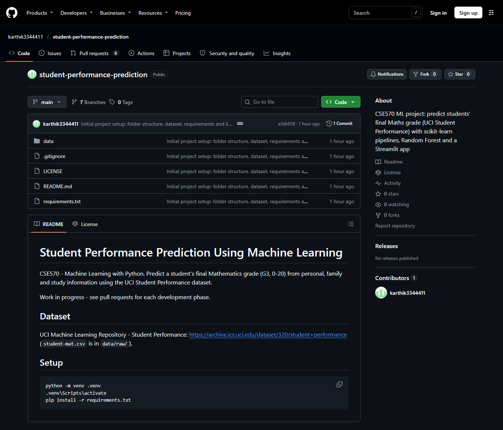

*Figure 20. Repository home page (screenshot captured 12 Nov 2026, 14:07 IST).*

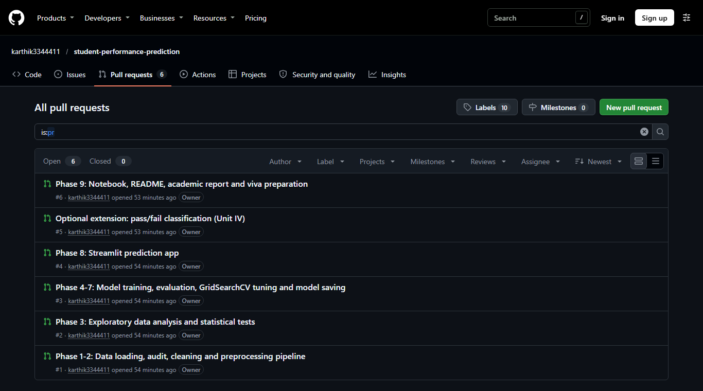

*Figure 21. Pull requests, one per development phase (screenshot captured 12 Nov 2026, 14:07 IST).*

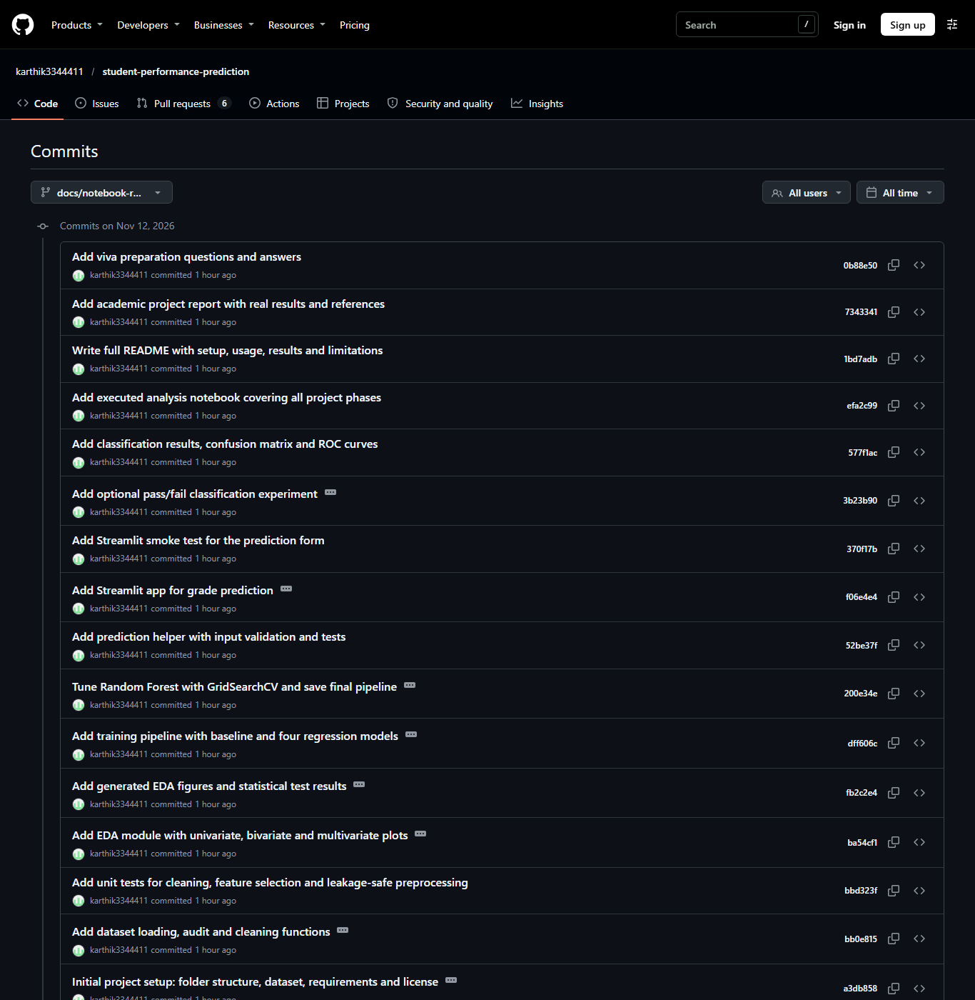

*Figure 22. Commit history with descriptive messages (screenshot captured 12 Nov 2026, 14:07 IST).*

### 12.2 Live Streamlit web application
- **App URL:** https://student-performance-karthik.streamlit.app
- **Hosting:** Streamlit Community Cloud, deployed directly from the GitHub repository (`app.py`, branch `docs/pdf-report`).
- **Features:** a validated form for all 30 model inputs, the predicted final grade with grade band and typical error range (± test MAE), the most influential features, a model-performance tab, and a dataset tab.

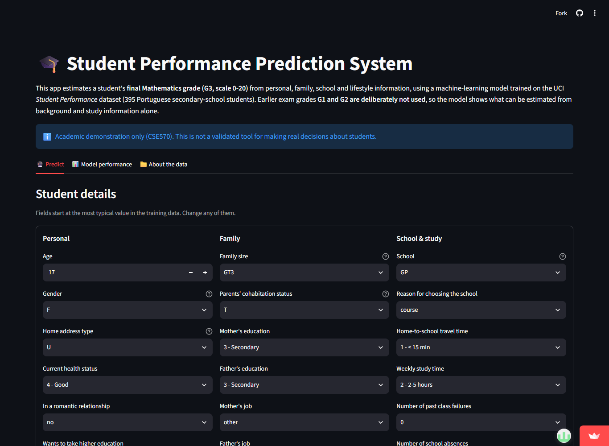

*Figure 23. The deployed Streamlit application (screenshot captured 12 Nov 2026, 15:34 IST).*

