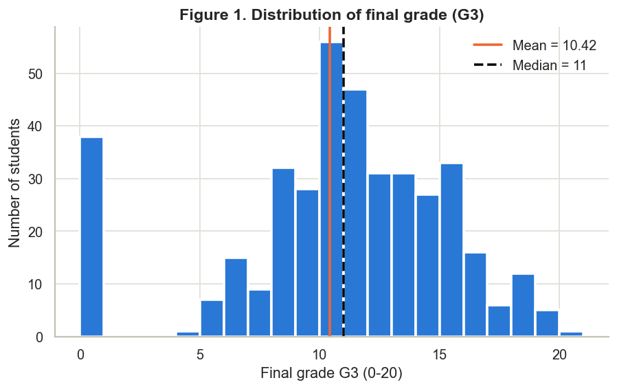
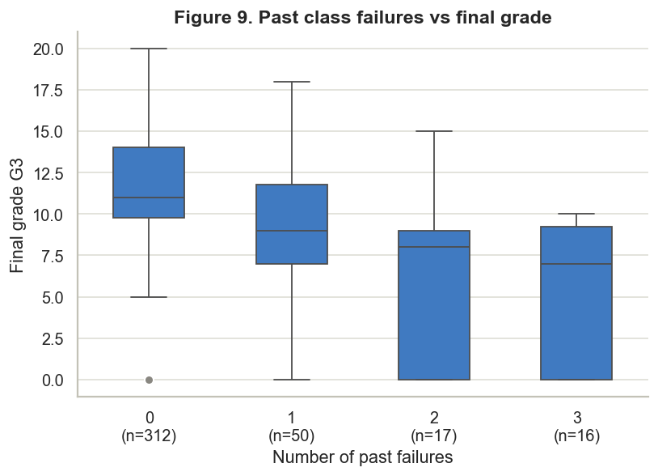
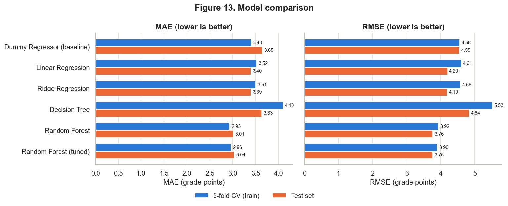
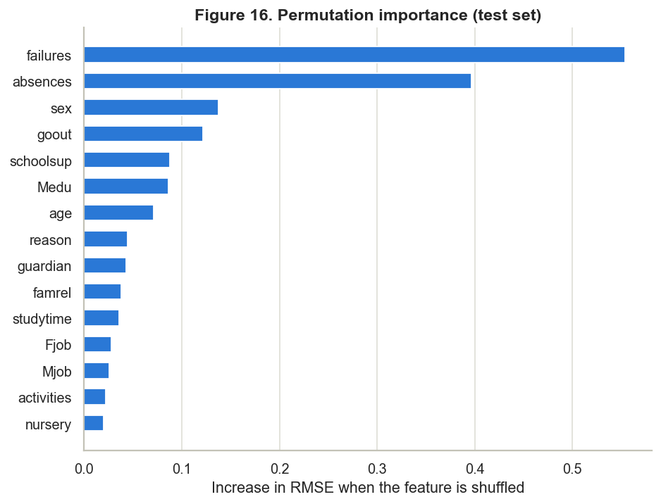
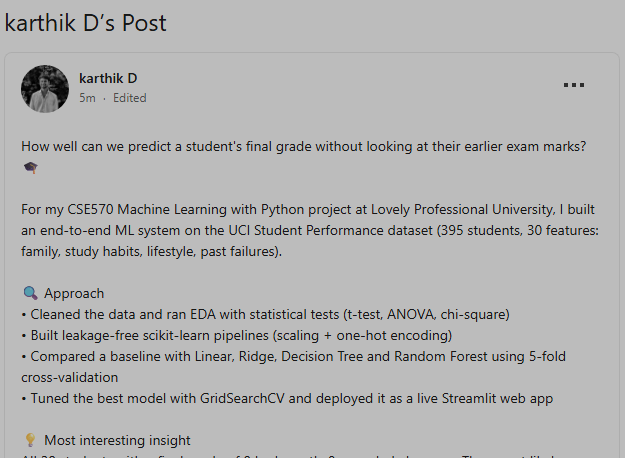

Lovely Professional University

CSE570 – Machine Learning with Python Academic Task 2 · Skill Based Assignment

<h1 class="main-title">Student Performance Prediction Using Machine Learning</h1>

An End-to-End Machine Learning Solution for a Real-World Problem

| | |
|---|---|
| **Student name** | Dondla Karthik |
| **Registration number** | 12625778 |
| **Roll number** | 37 |
| **Section** | K3P26DS |
| **Course code / title** | CSE570 – Machine Learning with Python |
| **GitHub repository** | https://github.com/karthik3344411/student-performance-prediction |
| **Live web app** | https://student-performance-karthik.streamlit.app |
| **LinkedIn post** | https://www.linkedin.com/feed/update/urn:li:activity:7526586805312258048/ |
| **Date of submission** | 12 November 2026 |

## Table of Contents
1. Title Page
2. [Abstract](#2-abstract)
3. [Introduction & Problem Statement](#3-introduction-problem-statement)
4. [Dataset Description](#4-dataset-description)
5. [Data Preprocessing](#5-data-preprocessing)
6. [Exploratory Data Analysis (EDA)](#6-exploratory-data-analysis-eda)
7. [Methodology](#7-methodology)
8. [Model Development](#8-model-development)
9. [Results & Model Comparison](#9-results-model-comparison)
10. [Conclusion & Limitations](#10-conclusion-limitations)
11. [References](#11-references)
12. [GitHub & LinkedIn Evidence](#12-github-linkedin-evidence)

## 2. Abstract
Schools usually learn which students are struggling only when the final results arrive. In this project I wanted to see how well a machine-learning model could estimate a student's final Mathematics grade (G3, on a 0–20 scale) from background information alone. I used the UCI Student Performance dataset, which describes 395 Portuguese secondary-school students through 30 attributes about family, school, study habits and lifestyle. I deliberately left out the two earlier period grades, G1 and G2, because they are almost identical to the final grade and would make the task trivial. Exploring the data showed that past class failures had the strongest link with the final grade (Spearman ρ = −0.36). It also revealed that every one of the 38 students with a final grade of 0 had zero recorded absences, which suggests they never sat the final exam. I compared five regression models using 5-fold cross-validation and tuned the best one, a Random Forest, with GridSearchCV. On a held-out test set it reached MAE 3.04, RMSE 3.76 and R² 0.31, against 3.65, 4.55 and −0.01 for a simple baseline. The final model runs inside a public Streamlit web app. Overall, background data gives a useful but rough estimate, and students who drop out are the hardest to predict.

**Keywords:** educational data mining, regression, random forest, cross-validation, scikit-learn pipeline, Streamlit

## 3. Introduction & Problem Statement

### 3.1 Introduction
Mathematics is one of those subjects where falling behind early tends to snowball. If a teacher could tell, a few months before the final exam, which students are likely to score poorly, there would still be time for extra classes or a conversation with the student. Machine learning is a natural fit for this, because the school already has records of past students and their results, and a model can pick up patterns in them that are hard to see by eye.

That was the starting point for this project. I built the whole pipeline myself: choosing the dataset, cleaning it, exploring it, training and comparing models, and finally putting the best one into a small web app that anyone can try. All the numbers in this report come straight from the code in my GitHub repository; I did not type any result in by hand.

### 3.2 Problem statement

| Item | Description |
|---|---|
| **Context** | Students at two Portuguese secondary schools taking Mathematics. Teachers would like an early warning about who might do badly. |
| **Target variable** | `G3`, the final Mathematics grade, a whole number from 0 to 20 (10 or more is a pass). |
| **ML task** | **Supervised regression**, since the target is a number. As an extra experiment I also tried pass/fail classification. |
| **Inputs** | 30 attributes covering the student's background, family, school, study habits and lifestyle. **G1 and G2 are not used.** |
| **Success criteria** | (1) The final model must beat a "predict the average" baseline on **both MAE and RMSE**, in cross-validation **and** on the test set. (2) No data leakage: every preprocessing step is learned from training data only. (3) A working app that always returns a grade between 0 and 20. |
| **Assumptions** | Past students are reasonably similar to future ones at the same schools, and the survey answers are mostly honest. |
| **Constraints** | Only 395 students; methods had to stay simple enough for me to explain in a viva; everything had to run on an ordinary Windows laptop. This is an academic exercise, not a tool for real decisions. |

**Why I dropped G1 and G2.** These are the first- and second-period grades from the same school year, and they correlate 0.80 and 0.90 with G3 (Figure 10). With them in the model, R² shoots up, but only because the model learns that "the final grade is roughly the last grade". That is not very helpful: by the time G2 is known, the year is almost over. Without them, the model has to rely on background factors, which is the more interesting and more useful question.

### 3.3 Objectives
1. Load the official UCI data and check its quality (types, missing values, duplicates).
2. Clean and prepare the data without leaking any test information into training.
3. Explore the data with summary statistics, charts and hypothesis tests.
4. Train a baseline plus at least three regression models and compare them on MAE, MSE, RMSE and R².
5. Tune the best model with GridSearchCV, using only the training data.
6. Understand what the final model relies on and where it goes wrong.
7. Save the full pipeline and build a Streamlit app around it.

### 3.4 Scope
- **In scope:** the Mathematics file (`student-mat.csv`); predicting G3 from the 30 non-grade features; standard scikit-learn models; a Streamlit app that runs locally and is also hosted publicly on Streamlit Community Cloud; an optional pass/fail experiment.
- **Out of scope:** the Portuguese-language file, deep learning, and any real-world use for decisions about individual students.

### 3.5 Applications
- **Early warning:** giving teachers a short list of students who might need a check-in.
- **Planning support:** roughly estimating how many students in a class may need tutoring.
- **Understanding factors:** seeing which background factors go together with lower or higher grades.
- **Learning resource:** the repository works as a complete, reproducible example of an ML project, from raw data to a deployed app.

## 4. Dataset Description

| Property | Value |
|---|---|
| Name | Student Performance (UCI Machine Learning Repository, ID 320) |
| Source | https://archive.ics.uci.edu/dataset/320/student+performance |
| Citation | Cortez, P. & Silva, A. (2008) [1], [2] |
| License | Creative Commons Attribution 4.0 (CC BY 4.0) |
| File used | `student-mat.csv` (Mathematics course), separated by `;` |
| Size | **395 records × 33 columns** (30 inputs + G1, G2, G3) |
| Feature types | 13 numeric (mostly ordinal scales) and 17 categorical (4 with several categories, 13 yes/no or two-valued) |
| Missing values / duplicates | **0 / 0** |
| Target variable | **G3** (0–20): mean 10.42, median 11, standard deviation 4.58, 95% CI of the mean [9.96, 10.87] |

### 4.1 Target (class) distribution

*Table 1. How the final grade G3 is spread across the 395 students.*

| G3 band | Students | Share |
|---|---|---|
| 0 (probably did not sit the exam) | 38 | 9.6% |
| 1–9 (fail) | 92 | 23.3% |
| 10–13 (pass) | 165 | 41.8% |
| 14–15 (good) | 60 | 15.2% |
| 16–20 (very good / excellent) | 40 | 10.1% |
| **Pass (G3 ≥ 10) / Fail (G3 < 10)** | **265 / 130** | **67.1% / 32.9%** |

For the main regression task the target is simply the numeric grade. For the pass/fail experiment, the two classes are somewhat unbalanced: roughly two students pass for every one who fails.

### 4.2 Data dictionary

*Table 2. Data dictionary, based on the description file supplied with the dataset.*

| # | Feature | Type | Meaning / values |
|---|---|---|---|
| 1 | school | binary | GP = Gabriel Pereira, MS = Mousinho da Silveira |
| 2 | sex | binary | F = female, M = male |
| 3 | age | numeric | 15–22 |
| 4 | address | binary | U = urban, R = rural |
| 5 | famsize | binary | LE3 = three or fewer, GT3 = more than three |
| 6 | Pstatus | binary | parents living together (T) or apart (A) |
| 7 | Medu | ordinal | mother's education: 0 none, 1 primary, 2 grades 5–9, 3 secondary, 4 higher |
| 8 | Fedu | ordinal | father's education (same scale) |
| 9 | Mjob | nominal | mother's job: teacher, health, services, at_home, other |
| 10 | Fjob | nominal | father's job (same options) |
| 11 | reason | nominal | why this school was chosen: home, reputation, course, other |
| 12 | guardian | nominal | mother, father, other |
| 13 | traveltime | ordinal | 1 under 15 min, 2 15–30 min, 3 30–60 min, 4 over 1 hour |
| 14 | studytime | ordinal | weekly study: 1 under 2 h, 2 2–5 h, 3 5–10 h, 4 over 10 h |
| 15 | failures | numeric | past class failures (0–3, where 3 means three or more) |
| 16 | schoolsup | binary | extra educational support from the school |
| 17 | famsup | binary | educational support from the family |
| 18 | paid | binary | extra paid classes in the subject |
| 19 | activities | binary | extra-curricular activities |
| 20 | nursery | binary | went to nursery school |
| 21 | higher | binary | wants to go on to higher education |
| 22 | internet | binary | internet access at home |
| 23 | romantic | binary | in a romantic relationship |
| 24 | famrel | ordinal | quality of family relationships, 1 (very bad) to 5 (excellent) |
| 25 | freetime | ordinal | free time after school, 1–5 |
| 26 | goout | ordinal | going out with friends, 1–5 |
| 27 | Dalc | ordinal | alcohol use on weekdays, 1–5 |
| 28 | Walc | ordinal | alcohol use at weekends, 1–5 |
| 29 | health | ordinal | current health, 1–5 |
| 30 | absences | numeric | number of school absences (allowed 0–93; highest in the data is 75) |
| 31 | G1 | numeric | first-period grade, 0–20 (**not used as an input**) |
| 32 | G2 | numeric | second-period grade, 0–20 (**not used as an input**) |
| 33 | **G3** | numeric | **final grade, 0–20 (the target)** |

### 4.3 Why I chose this dataset
- It is public, well documented and has been used in published research, so I could trust where it came from.
- It matches the problem exactly: real students and their real final grades.
- It has a healthy mix of numbers, ordered scales, yes/no answers and multi-category fields, so I had to use every preprocessing step from the course.
- It has no missing values, but it still hides real quirks (very skewed absences and a cluster of zero grades), which made the exploration worthwhile.
- With only 395 rows it trains in seconds, yet it is small enough that careful validation genuinely matters.

## 5. Data Preprocessing

*Table 3. What I checked, what I found and what I did about it.*

| Step | What I found | What I did |
|---|---|---|
| Loading | The file uses `;` instead of commas, and the grade values sit inside quotes (`"5"`) | Read it with `pd.read_csv(sep=";")`; pandas still reads the quoted grades as numbers |
| Data types | 16 numeric and 17 text columns, all matching the documentation | Ran `pd.to_numeric` on the numeric columns anyway as a safety check, and trimmed spaces in text columns |
| Missing values | None | Nothing to fix. The cleaning function would still fill numbers with the median and text with the most common value, and it never fills the target |
| Duplicates | None | `drop_duplicates()` removed nothing |
| Valid ranges | Every value was inside its documented range | `clean_data()` stops with an error if any value is ever out of range |
| Outliers (IQR rule) | `absences`: 15 values above 20 (maximum 75); `age`: one student aged 22; `failures`: 83 values flagged only because 79% of students have none | **Kept them all.** They are real, believable values, and tree-based models cope well with them. Removing them would also throw away students from an already small sample |
| G3 = 0 | 38 students (9.6%) | **Kept** as genuine outcomes, and investigated in Section 6.4 |
| Feature selection | G1 and G2 are almost the same as G3 | Removed from the inputs (see Section 3.2) |
| Encoding | 17 categorical columns | `OneHotEncoder(handle_unknown="ignore")`; the 30 inputs become 56 columns for the model |
| Scaling | Numeric columns on very different scales (absences 0–75, most others 1–5) | `StandardScaler`; this matters for Linear and Ridge Regression and does no harm to tree models |
| Train/test split | — | 80% for training (316 students), 20% for testing (79), with `random_state = 42` |

**Avoiding data leakage.** I put the scaler and the encoder inside a scikit-learn `Pipeline`, together with the model. This means they learn their means, standard deviations and category lists from the training data only, and during cross-validation from the training folds only. I also wrote a unit test that checks the scaler's learned means match the training-set means exactly.

*Figure 4. Absences are heavily skewed to the right (median 4, mean 5.7, maximum 75). The boxplot marks 15 high values as outliers.*

*Figure 5. Outlier check with IQR boxplots. No value falls outside its documented range.*

## 6. Exploratory Data Analysis (EDA)

### 6.1 Descriptive statistics

*Table 4. Summary statistics for the numeric columns (n = 395).*

| Variable | Mean | Median | Std | Min | Max |
|---|---|---|---|---|---|
| age | 16.70 | 17 | 1.28 | 15 | 22 |
| Medu | 2.75 | 3 | 1.09 | 0 | 4 |
| Fedu | 2.52 | 2 | 1.09 | 0 | 4 |
| traveltime | 1.45 | 1 | 0.70 | 1 | 4 |
| studytime | 2.04 | 2 | 0.84 | 1 | 4 |
| failures | 0.33 | 0 | 0.74 | 0 | 3 |
| famrel | 3.94 | 4 | 0.90 | 1 | 5 |
| freetime | 3.24 | 3 | 1.00 | 1 | 5 |
| goout | 3.11 | 3 | 1.11 | 1 | 5 |
| Dalc | 1.48 | 1 | 0.89 | 1 | 5 |
| Walc | 2.29 | 2 | 1.29 | 1 | 5 |
| health | 3.55 | 4 | 1.39 | 1 | 5 |
| absences | 5.71 | 4 | 8.00 | 0 | 75 |
| G1 | 10.91 | 11 | 3.32 | 3 | 19 |
| G2 | 10.71 | 11 | 3.76 | 0 | 19 |
| **G3** | **10.42** | **11** | **4.58** | **0** | **20** |

### 6.2 Univariate analysis

*Figure 1. Distribution of the final grade G3: mean 10.42 (95% CI 9.96–10.87), median 11.*

Most students scored between 8 and 15, but there is a separate spike at 0 made up of 38 students. That spike stops the distribution from being normal (Shapiro–Wilk W = 0.93, p < 0.001), so wherever I compared groups I also ran a non-parametric test alongside the usual one.

|  |  |
|---|---|
| *Figure 2. 208 female (53%) and 187 male (47%) students, a fairly even split.* | *Figure 3. Most students study 2–5 hours a week (198); only 27 study more than 10 hours.* |

### 6.3 Bivariate analysis and statistical tests

*Figure 9. Final grade grouped by the number of past failures.*

**Past failures.** This was the clearest pattern in the whole dataset. Students with no previous failures averaged 11.25 (n = 312). With one failure the average dropped to 8.12 (n = 50), with two to 6.24 (n = 17), and with three or more to 5.69 (n = 16). A Kruskal–Wallis test confirms that the groups really differ (H = 53.1, **p < 0.001**).

|  |  |
|---|---|
| *Figure 6. G3 by weekly study time (orange dots mark the group means).* | *Figure 7. G3 by gender.* |

- **Study time.** I expected this one to matter a lot, but the effect is weaker than I thought. The group averages are 10.05, 10.17, 11.40 and 11.26 for under 2, 2–5, 5–10 and over 10 hours a week. The trend points upwards, but it is **not statistically significant** at the 5% level (ANOVA F = 1.73, p = 0.161; Kruskal–Wallis p = 0.056).
- **Gender.** Male students averaged 10.91 and female students 9.97 (Welch t = −2.07, **p = 0.040**). The gap is real in this sample but small, about one grade point.
- **Wanting higher education.** 68.8% of students who plan to go on to higher education passed (n = 375), compared with 35.0% of those who do not (n = 20). The chi-square test is significant (χ² = 8.35, df = 1, **p = 0.004**), although only 20 students said "no", so I would not lean too heavily on the exact numbers.

*Table 5. Correlation of each numeric input with G3 (n = 395).*

| Feature | Spearman ρ | p-value | Pearson r |
|---|---|---|---|
| failures | −0.361 | < 0.001 | −0.360 |
| Medu | +0.225 | < 0.001 | +0.217 |
| age | −0.173 | < 0.001 | −0.162 |
| Fedu | +0.170 | < 0.001 | +0.152 |
| goout | −0.166 | < 0.001 | −0.133 |
| Dalc | −0.121 | 0.016 | −0.055 |
| traveltime | −0.121 | 0.017 | −0.117 |
| studytime | +0.105 | 0.037 | +0.098 |
| Walc | −0.104 | 0.038 | −0.052 |
| famrel | +0.055 | 0.276 | +0.051 |
| health | −0.048 | 0.343 | −0.061 |
| absences | +0.018 | 0.725 | +0.034 |
| freetime | −0.005 | 0.921 | +0.011 |

*Table 6. Average G3 (and group size) for a few categorical features.*

| Feature | Group A | Group B |
|---|---|---|
| higher | yes: 10.61 (375) | no: 6.80 (20) |
| address | urban: 10.67 (307) | rural: 9.51 (88) |
| internet | yes: 10.62 (329) | no: 9.41 (66) |
| romantic | no: 10.84 (263) | yes: 9.58 (132) |
| schoolsup | no: 10.56 (344) | yes: 9.43 (51) |
| paid | yes: 10.92 (181) | no: 9.99 (214) |
| school | GP: 10.49 (349) | MS: 9.85 (46) |

One result looks odd at first: students who get extra support from the school have *lower* grades. The likely explanation is that the school gives this support to students who are already struggling. It is a good reminder that a correlation on its own says nothing about cause and effect.

### 6.4 Key finding: the G3 = 0 group and absences

*Figure 8. Absences against final grade. The orange crosses are the 38 students with G3 = 0.*

When I first computed the correlation between absences and G3 over all students, it was practically zero (ρ = 0.02, p = 0.73). That surprised me, so I plotted the two against each other and noticed something strange: **every single one of the 38 students with G3 = 0 had exactly 0 absences.** Among the other students, only 21.6% had no absences at all. Twenty-five of those 38 still had a non-zero second-period grade, and on average they had more past failures (0.92) than everyone else (0.27).

The most sensible reading is that these students left the course or did not turn up for the final exam. Their grade was then recorded as 0, and their absences simply stopped being counted. Once I set them aside, absences show the relationship you would expect: **more absences go with lower grades (ρ = −0.24, p < 0.001)**. This pattern also explains why the Random Forest later ranks `absences` as one of its most important inputs.

### 6.5 Multivariate analysis

*Figure 10. Pearson correlations between the numeric variables (G1 and G2 are shown for reference only).*

The heatmap confirms how tightly G1, G2 and G3 are linked (0.80 to 0.90), which backs up my decision to leave G1 and G2 out. It also shows that some inputs move together: mother's and father's education (0.62), weekday and weekend alcohol use (0.65), and going out with weekend alcohol use (0.42). Correlated inputs like these make the individual coefficients of a plain linear regression unstable, which is one reason I also tried Ridge Regression.

|  |  |
|---|---|
| *Figure 11. Average G3 by study time and gender, with 95% confidence intervals.* | *Figure 12. Average G3 by wish for higher education and number of past failures.* |

In Figure 11 the confidence intervals overlap heavily, so neither gender nor study time makes a large, clear difference once you look at them together. Figure 12 shows that past failures pull grades down whether or not a student wants higher education; the best-performing group (wants higher education, no failures, n = 305) averages 11.3.

### 6.6 What I took away from the EDA
1. Past failures are the strongest warning sign of a low final grade.
2. Mother's education, wanting higher education, going out, age, and absences (for students who sat the exam) carry weaker signals.
3. Study time, family relationships, free time and health show little or no relationship with G3.
4. The 38 zero grades behave like a separate group, probably students who dropped out, and they distort simple statistics.
5. Everything above is an association. None of it proves that changing one factor would change a student's grade.

## 7. Methodology

*Figure 0. The complete workflow I followed in this project.*

1. **Getting the data:** downloaded the official UCI file and loaded it with pandas.
2. **Auditing and cleaning:** checked types, missing values, duplicates, value ranges and outliers (Section 5).
3. **EDA:** single-variable, two-variable and multi-variable analysis with hypothesis tests (Section 6).
4. **Choosing inputs and target:** 30 input features, G3 as the target, G1 and G2 removed.
5. **Splitting:** 316 training students and 79 test students (`random_state = 42`).
6. **Building the pipeline:** a `ColumnTransformer` (`StandardScaler` + `OneHotEncoder`) followed by the model, so that nothing from the validation or test data leaks into preprocessing.
7. **Comparing models:** 5-fold cross-validation on the training set only, ranking models by CV RMSE and CV MAE together.
8. **Tuning:** `GridSearchCV` on the best model, again with training data only.
9. **Final check:** each model is scored **once** on the untouched test set.
10. **Interpreting:** residual plots plus permutation and impurity-based feature importance.
11. **Deploying:** the whole pipeline is saved with `joblib` and loaded by a Streamlit app, which is hosted at https://student-performance-karthik.streamlit.app (Section 12.2).

**Why cross-validation matters here.** With only 79 students in the test set, a single split is noisy and can rank models by luck. Section 9.3 shows that this actually happened in my results. By making every decision with 5-fold cross-validation and touching the test set only at the very end, I get a fairer final estimate.

**Tools used:** Python 3.10, pandas 2.3, NumPy 2.2, scikit-learn 1.7, SciPy 1.15, Matplotlib 3.10, Seaborn 0.13, Joblib 1.6, Streamlit 1.65 and pytest 9.2 (21 automated tests).

## 8. Model Development

Every model uses exactly the same preprocessing pipeline, so the comparison is fair.

*Table 7. The models I trained and why.*

| Model | Why I included it | Starting settings |
|---|---|---|
| **Dummy Regressor (baseline)** | Always predicts the training average (about 10.4). Any model worth using has to beat this | `strategy="mean"` |
| **Linear Regression** | The simplest real model, and easy to interpret | default |
| **Ridge Regression** | Linear regression with an L2 penalty, which handles correlated inputs better | `alpha=1.0` |
| **Decision Tree Regressor** | Can capture non-linear patterns and interactions | `random_state=42`, no depth limit |
| **Random Forest Regressor** | Averages many trees to reduce the overfitting of a single tree | `n_estimators=300`, `random_state=42` |

**Training and choosing a model.** I scored each pipeline with 5-fold cross-validation on the 316 training students, recording MAE, RMSE and R². I then ranked the four real models by CV RMSE and by CV MAE, and **Random Forest** came first on both. I did not choose by R² alone: MAE and RMSE are measured in grade points, which makes them much easier to explain to a teacher ("the prediction is usually about three points off").

**Hyperparameter tuning.** I then used `GridSearchCV` (5-fold, scored by RMSE, training data only) to try 2 × 3 × 3 × 3 = **54 combinations**, which is 270 model fits in total:

*Table 8. The Random Forest settings I searched over.*

| Hyperparameter | Values tried | What it controls | Best |
|---|---|---|---|
| `n_estimators` | 200, 500 | number of trees | **200** |
| `max_depth` | None, 6, 10 | how deep each tree can grow | **None** |
| `min_samples_leaf` | 1, 3, 5 | smallest number of students allowed in a leaf | **1** |
| `max_features` | 1.0, 0.5, "sqrt" | share of features each split may look at | **0.5** |

I wanted to see whether limiting depth or the number of features would reduce overfitting. The winning setting lets each split consider only half of the features, which makes the trees more varied. I kept the tuned version because its **cross-validation** RMSE was lower (3.897 against 3.925); the test set had no say in this choice. The final pipeline is saved as `models/best_model.joblib` (4.3 MB), and its metrics are stored in `models/model_metrics.json` for the app to display.

## 9. Results & Model Comparison

### 9.1 Evaluation metrics
- **MAE** (mean absolute error): on average, how many grade points the prediction is off by.
- **MSE** (mean squared error): like MAE, but large mistakes count much more.
- **RMSE:** the square root of MSE, which brings it back to grade points.
- **R²:** how much of the variation in G3 the model explains. 0 means no better than always guessing the average; a negative value means worse than that.

### 9.2 How the final model performed

*Table 9. Final model against the baseline on the held-out test set (79 students).*

| Metric | Baseline | Final model (tuned Random Forest) | Improvement |
|---|---|---|---|
| MAE | 3.646 | **3.035** | −0.61 (−17%) |
| MSE | 20.704 | **14.145** | −6.56 (−32%) |
| RMSE | 4.550 | **3.761** | −0.79 (−17%) |
| R² | −0.010 | **0.310** | +0.32 |

### 9.3 Comparing all the models

*Table 10. Every model on the test set (79 students) and in 5-fold cross-validation on the training set (316 students).*

| Model | Test MAE | Test MSE | Test RMSE | Test R² | CV MAE | CV RMSE | CV R² | Train RMSE |
|---|---|---|---|---|---|---|---|---|
| Dummy (baseline) | 3.646 | 20.704 | 4.550 | −0.010 | 3.403 | 4.563 | −0.035 | 4.583 |
| Linear Regression | 3.395 | 17.604 | 4.196 | 0.141 | 3.523 | 4.607 | −0.092 | 3.865 |
| Ridge Regression | 3.393 | 17.585 | 4.193 | 0.142 | 3.506 | 4.584 | −0.080 | 3.865 |
| Decision Tree | 3.633 | 23.405 | 4.838 | −0.141 | 4.102 | 5.527 | −0.570 | 0.000 |
| Random Forest | **3.010** | 14.175 | 3.765 | 0.309 | **2.934** | 3.925 | 0.212 | 1.457 |
| **RF (tuned), final** | 3.035 | **14.145** | **3.761** | **0.310** | 2.960 | **3.897** | **0.232** | 1.451 |

*Figure 13. MAE and RMSE for every model (blue = 5-fold CV, orange = test set).*

- **Linear and Ridge Regression.** On the test set both look better than the baseline (R² 0.14). In cross-validation, though, both are *worse* than the baseline (CV R² below 0). If I had relied on that one test split, I would have drawn the wrong conclusion, which is exactly why I made my decisions with cross-validation.
- **Decision Tree.** It scored a perfect 0.00 RMSE on the training data but 5.53 in cross-validation. It had simply memorised the training students, a textbook example of **overfitting**.
- **Random Forest.** Averaging many different trees fixes most of that problem. It was the best model in cross-validation and on the test set, and it can pick up non-linear patterns that the linear models miss. Its training RMSE (1.45) is still well below its CV RMSE (3.90), so some overfitting remains.
- **Tuned vs default Random Forest.** Tuning helped only a little (CV RMSE 3.925 → 3.897). On the test set the RMSE barely moved (3.765 → 3.761), and the MAE was actually slightly worse (3.010 → 3.035). In practice the two are equally good; I kept the tuned one because that is what my cross-validation rule said to do.
- **Why this is my final model.** The tuned Random Forest has the lowest CV RMSE and the best test RMSE, MSE and R². It improves on the baseline by 17% on both MAE and RMSE, which meets the success criterion I set at the start.

### 9.4 Understanding the model's behaviour

|  |  |
|---|---|
| *Figure 14. Actual vs predicted G3 on the test set.* | *Figure 15. Residuals against predictions, and how the residuals are distributed.* |

- The predictions bunch up in the middle (roughly 8 to 14). The model plays it safe and rarely predicts very high or very low grades.
- The residuals are centred close to zero (mean −0.18), so the model is not consistently too high or too low. 43% of predictions are within 2 points of the real grade, and 73% within 4 points.
- The biggest misses are the five test students whose real grade was 0. For them the average error is **8.06** points, against **2.70** for the other 74 students. From background data alone, the model cannot tell who is going to drop out.

|  |  |
|---|---|
| *Figure 16. Permutation importance on the test set: how much the RMSE gets worse when one feature is shuffled.* | *Figure 17. The Random Forest's own impurity-based importance.* |

Both importance methods agree that **failures** and **absences** matter most. After those come going out, gender, school support, mother's education and age. As a cross-check, the scaled Linear Regression coefficients point in the same directions: about −1.36 grade points per standard deviation of past failures, +0.88 for wanting higher education, +0.75 for male students and +0.63 for more study time.

### 9.5 Extra experiment: pass/fail classification
Out of curiosity, I also turned the problem into a yes/no question: does the student **pass (G3 ≥ 10) or fail**? 67.1% of students pass. I kept the same features and pipeline, used a stratified 80/20 split, and set the models to balance the two classes.

*Table 11. Pass/fail results on the test set (precision, recall and F1 are for the "fail" class).*

| Model | CV macro-F1 | Accuracy | Precision | Recall | F1 | Macro-F1 | ROC-AUC |
|---|---|---|---|---|---|---|---|
| Dummy (always "pass") | 0.402 | **0.671** | 0.000 | 0.000 | 0.000 | 0.402 | 0.500 |
| **Logistic Regression** | **0.652** | 0.595 | 0.400 | **0.462** | **0.429** | 0.557 | 0.595 |
| Decision Tree (depth 4) | 0.568 | 0.519 | 0.333 | 0.462 | 0.387 | 0.496 | 0.466 |
| Random Forest | 0.591 | 0.684 | **0.529** | 0.346 | 0.419 | **0.601** | **0.652** |

|  |  |
|---|---|
| *Figure 18. Confusion matrix for Logistic Regression: it caught 12 of the 26 failing students.* | *Figure 19. ROC curves for the three classifiers.* |

The most useful lesson here was about accuracy. The baseline that always says "pass" has the highest accuracy of all (0.67), yet it does not catch a single failing student. When the classes are unbalanced, recall and F1 for the smaller class tell you far more. All the classifiers are only moderately better than chance (ROC-AUC 0.47 to 0.65), which matches what the regression results already showed.

## 10. Conclusion & Limitations

### 10.1 Conclusion
I built a complete, reproducible machine-learning project that estimates a student's final Mathematics grade from background information, without looking at earlier exam marks. After a fair, leakage-free comparison of five models, a tuned Random Forest came out on top (test MAE 3.04, RMSE 3.76, R² 0.31), clearly ahead of the baseline, the linear models and a single decision tree. Past failures and absences turned out to be the most important factors. The most interesting discovery was the group of students with a final grade of 0, who look like students who dropped out; they behave very differently from everyone else, and the model struggles to predict them. The finished model is available as a public Streamlit web app (https://student-performance-karthik.streamlit.app). In its current form it could serve as a rough, explainable early-warning signal. Its accuracy is modest, though, so it should only ever support a teacher's judgement, never replace it.

### 10.2 Limitations
- **Small sample.** 395 students, with only 79 in the test set, so the numbers carry real uncertainty (the CV RMSE varies by about ±0.37 between folds).
- **Narrow setting.** Two schools in Portugal, one subject, data from 2005–2006. The results may not hold elsewhere or today.
- **Self-reported, sensitive data.** Answers about alcohol or family life may not be accurate, and using things like gender or family background to make decisions about a student raises fairness concerns.
- **The G3 = 0 group.** Students who probably dropped out are mixed in with genuinely low scores under one numeric target.
- **Modest accuracy.** R² is about 0.31, and the predictions are pulled towards the average.
- **Associations, not causes.** Nothing here shows that changing a factor, such as study time, would change a student's grade.

### 10.3 Future improvements
- Treat the G3 = 0 students separately: first predict who is likely to drop out, then predict the grade for everyone else.
- Add the Portuguese-language file (649 more students) to get more training data.
- Try gradient-boosting models and SHAP explanations, and use repeated or nested cross-validation for steadier estimates.
- Check whether the model's errors differ between groups, such as gender, address and school, before any real use.
- Add K-Means clustering with PCA (syllabus Unit V) to look for natural student profiles.

## 11. References
1. P. Cortez and A. Silva, "Using Data Mining to Predict Secondary School Student Performance," in *Proc. 5th FUture BUsiness TEChnology Conference (FUBUTEC 2008)*, Porto, Portugal: EUROSIS, 2008, pp. 5–12.
2. P. Cortez, "Student Performance," UCI Machine Learning Repository, 2008. DOI: 10.24432/C5TG7T. https://archive.ics.uci.edu/dataset/320/student+performance
3. F. Pedregosa *et al.*, "Scikit-learn: Machine Learning in Python," *Journal of Machine Learning Research*, vol. 12, pp. 2825–2830, 2011.
4. W. McKinney, "Data Structures for Statistical Computing in Python," in *Proc. 9th Python in Science Conference*, 2010, pp. 56–61.
5. C. R. Harris *et al.*, "Array programming with NumPy," *Nature*, vol. 585, pp. 357–362, 2020.
6. P. Virtanen *et al.*, "SciPy 1.0: Fundamental Algorithms for Scientific Computing in Python," *Nature Methods*, vol. 17, pp. 261–272, 2020.
7. J. D. Hunter, "Matplotlib: A 2D Graphics Environment," *Computing in Science & Engineering*, vol. 9, no. 3, pp. 90–95, 2007.
8. M. L. Waskom, "seaborn: statistical data visualization," *Journal of Open Source Software*, vol. 6, no. 60, p. 3021, 2021.
9. L. Breiman, "Random Forests," *Machine Learning*, vol. 45, no. 1, pp. 5–32, 2001.
10. Streamlit Inc., *Streamlit documentation*, https://docs.streamlit.io
11. Joblib developers, *Joblib documentation*, https://joblib.readthedocs.io

## 12. GitHub & LinkedIn Evidence

| Evidence | Link |
|---|---|
| **GitHub repository** | https://github.com/karthik3344411/student-performance-prediction |
| **Live Streamlit app** | https://student-performance-karthik.streamlit.app |
| **LinkedIn post** | https://www.linkedin.com/feed/update/urn:li:activity:7526586805312258048/ |

### 12.1 GitHub repository
- **What it contains:** README, problem and objectives, dataset source, Python scripts (`src/`), the executed notebook, `requirements.txt`, the saved model, all figures, this report, viva questions and 21 automated tests.
- **How I worked:** branch-based development, with one feature branch and one pull request for each stage of the project.

*Table 12. Pull requests (opened 12 November 2026).*

| PR | Branch | Title |
|---|---|---|
| #1 | feature/data-preprocessing | Phase 1-2: Data loading, audit, cleaning and preprocessing pipeline |
| #2 | feature/eda-statistical-analysis | Phase 3: Exploratory data analysis and statistical tests |
| #3 | feature/model-training-and-tuning | Phase 4-7: Model training, evaluation, GridSearchCV tuning and model saving |
| #4 | feature/streamlit-app | Phase 8: Streamlit prediction app |
| #5 | feature/classification-extension | Optional extension: pass/fail classification (Unit IV) |
| #6 | docs/notebook-report-readme | Phase 9: Notebook, README, academic report and viva preparation |
| #7 | docs/pdf-report | Final report in CSE570 format (PDF) with GitHub evidence |

*Table 13. Commit history (all commits by karthik3344411, 12 November 2026).*

| Commit | Message |
|---|---|
| a3db858 | Initial project setup: folder structure, dataset, requirements and license |
| bb0e815 | Add dataset loading, audit and cleaning functions |
| bbd323f | Add unit tests for cleaning, feature selection and leakage-safe preprocessing |
| ba54cf1 | Add EDA module with univariate, bivariate and multivariate plots |
| fb2c2e4 | Add generated EDA figures and statistical test results |
| dff606c | Add training pipeline with baseline and four regression models |
| 200e34e | Tune Random Forest with GridSearchCV and save final pipeline |
| 52be37f | Add prediction helper with input validation and tests |
| f06e4e4 | Add Streamlit app for grade prediction |
| 370f17b | Add Streamlit smoke test for the prediction form |
| 3b23b90 | Add optional pass/fail classification experiment |
| 577f1ac | Add classification results, confusion matrix and ROC curves |
| efa2c99 | Add executed analysis notebook covering all project phases |
| 1bd7adb | Write full README with setup, usage, results and limitations |
| 7343341 | Add academic project report with real results and references |
| 0b88e50 | Add viva preparation questions and answers |
| 3727b52 | Add workflow flowchart figure for the methodology section |
| 398b602 | Add dated GitHub evidence screenshots (repository, pull requests, commits) |
| 254e88e | Restructure report into the 12-section CSE570 report format |
| 228c748 | Add PDF build script and generated Project_Report.pdf |
| 91ba7db | Add student registration number, roll number and section to the title page |
| b9efef1 | Finalize report: remove faculty and LinkedIn placeholders |
| 5bd93e3 | Replace deprecated use_container_width with width='stretch' for Streamlit Cloud |
| 4835771 | Split requirements: lean runtime list for Streamlit Cloud, dev tools in requirements-dev.txt |
| 420b3f3 | Add live Streamlit Cloud app link and screenshot to README and report |

*Figure 20. Repository home page (screenshot taken 12 November 2026, 14:07 IST).*

*Figure 21. Pull requests, one for each stage of the project (screenshot taken 12 November 2026, 14:07 IST).*

*Figure 22. Commit history with descriptive messages (screenshot taken 12 November 2026, 14:07 IST).*

### 12.2 Live Streamlit web app
- **Link:** https://student-performance-karthik.streamlit.app
- **Hosting:** Streamlit Community Cloud, deployed straight from the GitHub repository (`app.py`).
- **What it does:** a form with checks on all 30 model inputs; the predicted final grade with a grade band and a typical error range (± test MAE); the most influential features; plus tabs showing model performance and dataset information.

*Figure 23. The deployed Streamlit app (screenshot taken 12 November 2026, 15:34 IST).*

### 12.3 LinkedIn post
- **Link:** https://www.linkedin.com/feed/update/urn:li:activity:7526586805312258048/
- **What the post covers:** the problem, the dataset, my approach, the key insight (the G3 = 0 and absences finding), the best-model result (tuned Random Forest, MAE 3.04 against a baseline of 3.65), my main learning, and links to the GitHub repository and the live app.

*Figure 24. The published LinkedIn post (screenshot taken 12 November 2026, 15:44 IST).*

