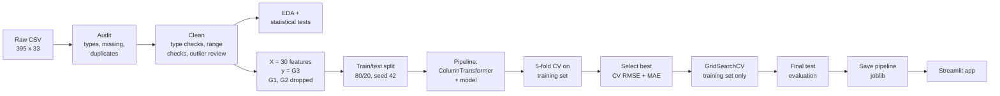

<div align="center">

# Student Performance Prediction Using Machine Learning

### End-to-End Machine Learning Solution for a Real-World Problem

**Course:** CSE570 – Machine Learning with Python
**Academic Task 2 – Skill Based Assignment**

| | |
|---|---|
| **Student name** | Dondla Karthik |
| **Registration number** | _[fill in]_ |
| **Section / Roll number** | _[fill in]_ |
| **Submitted to** | _[faculty name]_ |
| **GitHub repository** | https://github.com/karthik3344411/student-performance-prediction |
| **LinkedIn post** | _[add link after publishing]_ |
| **Date** | November 2026 |

Lovely Professional University

</div>

---

## Table of Contents
1. [Abstract](#abstract)
2. [Introduction](#1-introduction)
3. [Problem Statement](#2-problem-statement)
4. [Objectives](#3-objectives)
5. [Dataset Description](#4-dataset-description)
6. [Methodology](#5-methodology)
7. [Data Cleaning and Preprocessing](#6-data-cleaning-and-preprocessing)
8. [Exploratory Data Analysis](#7-exploratory-data-analysis)
9. [Model Development](#8-model-development)
10. [Model Evaluation](#9-model-evaluation)
11. [Model Comparison](#10-model-comparison)
12. [Results and Discussion](#11-results-and-discussion)
13. [Conclusion](#12-conclusion)
14. [Limitations](#13-limitations)
15. [Future Scope](#14-future-scope)
16. [References](#15-references)
17. [Appendix – Reproducing the Results](#appendix--reproducing-the-results)

---

## Abstract
This project builds an end-to-end machine-learning system that estimates a secondary-school student's final Mathematics grade (G3, scale 0–20) from 30 demographic, family, school and lifestyle attributes of the UCI *Student Performance* dataset (395 students). Earlier period grades (G1, G2) are deliberately excluded so that the model reflects what can be predicted from background information alone. After auditing and cleaning the data, exploratory analysis with hypothesis tests showed that past class failures are the strongest single correlate of the final grade (Spearman ρ = −0.36) and revealed that all 38 students with G3 = 0 have zero recorded absences, which suggests they did not sit the final exam. Five regression pipelines (mean baseline, Linear, Ridge, Decision Tree, Random Forest) were compared with 5-fold cross-validation on a training set and evaluated once on a held-out test set. A Random Forest tuned with GridSearchCV performed best (test MAE 3.04, RMSE 3.76, R² 0.31, against 3.65 / 4.55 / −0.01 for the baseline). The final pipeline is saved with Joblib and served through a Streamlit web application. An optional pass/fail classification experiment is also reported. The results show that background data gives a useful but coarse estimate of performance, and that the largest errors come from students who probably dropped out.

**Keywords:** educational data mining, regression, random forest, cross-validation, scikit-learn pipeline, Streamlit

---

## 1. Introduction
Academic performance in core subjects such as Mathematics strongly affects students' future options. If a school can recognise students who are likely to struggle early, teachers can offer tutoring, counselling or other support before the final exam. Machine learning can learn patterns from historical records (for example, that students with previous failures tend to score lower) and apply them to new students.

This report documents the complete workflow: problem definition, dataset analysis, cleaning, exploratory and statistical analysis, model development with leakage-safe pipelines, hyperparameter tuning, evaluation, and deployment as a simple web application. All numbers in this report were produced by the code in the repository; nothing was entered by hand.

## 2. Problem Statement

| Item | Description |
|---|---|
| **Context** | Portuguese secondary-school students (two schools) taking Mathematics. Teachers need an early indication of which students may perform poorly. |
| **Target variable** | `G3` – final Mathematics grade, integer 0–20 (≥ 10 is a pass). |
| **ML task** | **Supervised regression** (predict a numeric grade). An optional binary classification (pass/fail) is reported as an extension. |
| **Inputs** | 30 attributes: demographics, family background, school, study habits and lifestyle. **G1 and G2 are excluded.** |
| **Intended users / impact** | Teachers and academic counsellors, as a *decision-support* signal to prioritise attention, never as an automatic decision. |
| **Success criteria** | (1) The final model beats a mean-predicting baseline on **both MAE and RMSE** in cross-validation **and** on the held-out test set; (2) no data leakage (all preprocessing fitted on training data only); (3) a working application that returns a prediction in the valid range 0–20. |
| **Assumptions** | Historical records are representative of future students in the same schools; survey answers are reasonably truthful; the 2005–2006 relationships still hold. |
| **Constraints** | Small dataset (395 rows); beginner-friendly, explainable methods; runs on a normal Windows laptop; academic demonstration only. |

**Why exclude G1 and G2?** They are the first- and second-period grades of the same course. Their Pearson correlations with G3 are 0.80 and 0.90 (Figure 10). Including them would give a high R² simply because "the final grade is close to the previous grade". That model would only be usable late in the year and would hide which background factors matter. Cortez and Silva (2008) also report setups with and without these grades for the same reason.

## 3. Objectives
1. Load and audit the official UCI dataset (shape, types, missing values, duplicates).
2. Clean and preprocess the data without data leakage (encoding, scaling, train/test split inside pipelines).
3. Perform univariate, bivariate and multivariate EDA with descriptive statistics and at least one statistical test.
4. Identify relationships between study habits/background and final grades.
5. Train a baseline and at least three regression models; compare them with MAE, MSE, RMSE and R².
6. Tune the best model with GridSearchCV using cross-validation on the training data only.
7. Interpret the final model (feature importance, residuals) and state its limitations.
8. Save the complete pipeline and build a Streamlit application for predictions.

## 4. Dataset Description

| Property | Value |
|---|---|
| Name | Student Performance (UCI Machine Learning Repository, ID 320) |
| Source | https://archive.ics.uci.edu/dataset/320/student+performance |
| Citation | Cortez, P. & Silva, A. (2008) [1] |
| License | Creative Commons Attribution 4.0 (CC BY 4.0) |
| File used | `student-mat.csv` (Mathematics course), separator `;` |
| Records × columns | **395 × 33** (30 input attributes + G1, G2, G3) |
| Feature types | 13 numeric (mostly ordinal scales) + 17 categorical (4 nominal multi-class, 13 binary) |
| Missing values | **0** in all columns |
| Duplicate rows | **0** |
| Target | G3 (0–20); mean 10.42, median 11, std 4.58, 95% CI of mean [9.96, 10.87] |
| Target distribution | 38 students (9.6%) have G3 = 0; otherwise roughly bell-shaped from 4 to 20 (Figure 1). Pass rate (G3 ≥ 10): 67.1% |

### 4.1 Data dictionary

| # | Feature | Type | Description / values |
|---|---|---|---|
| 1 | school | binary | GP = Gabriel Pereira, MS = Mousinho da Silveira |
| 2 | sex | binary | F = female, M = male |
| 3 | age | numeric | 15–22 |
| 4 | address | binary | U = urban, R = rural |
| 5 | famsize | binary | LE3 = ≤ 3, GT3 = > 3 |
| 6 | Pstatus | binary | parents living together (T) or apart (A) |
| 7 | Medu | ordinal | mother's education 0 none, 1 primary, 2 5th–9th grade, 3 secondary, 4 higher |
| 8 | Fedu | ordinal | father's education (same scale) |
| 9 | Mjob | nominal | mother's job: teacher, health, services, at_home, other |
| 10 | Fjob | nominal | father's job (same categories) |
| 11 | reason | nominal | reason for choosing the school: home, reputation, course, other |
| 12 | guardian | nominal | mother, father, other |
| 13 | traveltime | ordinal | 1 < 15 min, 2 15–30 min, 3 30–60 min, 4 > 1 h |
| 14 | studytime | ordinal | weekly study: 1 < 2 h, 2 2–5 h, 3 5–10 h, 4 > 10 h |
| 15 | failures | numeric | past class failures (0–3; 3 means 3 or more) |
| 16 | schoolsup | binary | extra educational support from school |
| 17 | famsup | binary | family educational support |
| 18 | paid | binary | extra paid classes in the subject |
| 19 | activities | binary | extra-curricular activities |
| 20 | nursery | binary | attended nursery school |
| 21 | higher | binary | wants to take higher education |
| 22 | internet | binary | internet access at home |
| 23 | romantic | binary | in a romantic relationship |
| 24 | famrel | ordinal | quality of family relationships 1 (very bad) – 5 (excellent) |
| 25 | freetime | ordinal | free time after school 1–5 |
| 26 | goout | ordinal | going out with friends 1–5 |
| 27 | Dalc | ordinal | workday alcohol consumption 1–5 |
| 28 | Walc | ordinal | weekend alcohol consumption 1–5 |
| 29 | health | ordinal | current health status 1–5 |
| 30 | absences | numeric | number of school absences (0–93; observed max 75) |
| 31 | G1 | numeric | first-period grade 0–20 – **not used as input** |
| 32 | G2 | numeric | second-period grade 0–20 – **not used as input** |
| 33 | **G3** | numeric | **final grade 0–20 – target** |

### 4.2 Why this dataset is appropriate
- It is a well-documented, peer-reviewed public dataset that matches the problem exactly: real student records with a real final grade.
- It contains a mix of numeric, ordinal, binary and nominal features, so it exercises every preprocessing step (scaling, one-hot encoding) taught in the course.
- It has no missing values, so the analysis can focus on modelling, yet it has real data-quality issues (skewed absences, a group of zero grades) to investigate.
- Its size (395 rows) trains in seconds on a laptop, but is small enough that careful validation (cross-validation, baseline comparison) really matters.

## 5. Methodology



*Figure 0. Project workflow.*

**Validation strategy.** The data is split once into 316 training and 79 test students (`random_state = 42`). All model selection and tuning decisions use **5-fold cross-validation on the training set only**. The test set is used exactly once per model, for the final report. This matters because with only 79 test students a single split can be noisy: a model can look good or bad by chance (Section 10 shows a real example).

**Leakage prevention.** Scaling and encoding are placed inside a scikit-learn `Pipeline` together with the model. When `cross_validate`, `GridSearchCV` or `fit` is called, the `StandardScaler` learns its means and standard deviations, and the `OneHotEncoder` learns its categories, **only from the training portion**. A unit test (`test_preprocessor_fits_on_training_only`) checks that the learned means equal the training means.

**Software.** Python 3.10, pandas 2.3, NumPy 2.2, scikit-learn 1.7, SciPy 1.15, Matplotlib 3.10, Seaborn 0.13, Joblib 1.6, Streamlit 1.65, pytest 9.2.

## 6. Data Cleaning and Preprocessing

| Step | Finding | Action |
|---|---|---|
| Loading | File is `;`-separated; grade values are quoted (`"5"`) | `pd.read_csv(sep=";")`; pandas parses quoted grades as integers |
| Data types | 16 numeric, 17 text columns, all as documented | `pd.to_numeric` on numeric columns (safety), strip spaces on text |
| Missing values | 0 | None needed. The code still fills numeric columns with the median and text columns with the mode, and never fills the target |
| Duplicates | 0 exact duplicates | `drop_duplicates()` (no rows removed) |
| Range validation | Every value lies inside the official range | `clean_data()` raises an error if any value is out of range |
| Outliers (IQR rule) | `absences`: 15 values > 20 (max 75); `age`: one 22-year-old; `failures`: 83 "outliers" only because 79% have 0 | **Kept.** They are plausible, real observations, and tree models are robust to them. Removing them would discard real students from an already small dataset |
| G3 = 0 | 38 students (9.6%) | **Kept** as real outcomes; analysed in Section 7.4 and treated as a limitation |
| Feature selection | G1, G2 strongly correlated with G3 | Excluded from inputs (Section 2) |
| Encoding | 17 categorical columns | `OneHotEncoder(handle_unknown="ignore")` → 30 inputs become 56 model columns |
| Scaling | 13 numeric columns on different scales (absences 0–75 vs. 1–5 scales) | `StandardScaler` (needed for Linear/Ridge, harmless for trees) |
| Split | — | 80% train (316) / 20% test (79), `random_state = 42` |


*Figure 4. Absences are strongly right-skewed (median 4, mean 5.7, max 75); the boxplot marks 15 high values as IQR outliers.*


*Figure 5. Outlier inspection. No values fall outside the documented ranges.*

## 7. Exploratory Data Analysis

### 7.1 Descriptive statistics

*Table 1. Descriptive statistics of numeric variables (n = 395).*

| Variable | Mean | Median | Std | Min | Max |
|---|---|---|---|---|---|
| age | 16.70 | 17 | 1.28 | 15 | 22 |
| Medu | 2.75 | 3 | 1.09 | 0 | 4 |
| Fedu | 2.52 | 2 | 1.09 | 0 | 4 |
| traveltime | 1.45 | 1 | 0.70 | 1 | 4 |
| studytime | 2.04 | 2 | 0.84 | 1 | 4 |
| failures | 0.33 | 0 | 0.74 | 0 | 3 |
| famrel | 3.94 | 4 | 0.90 | 1 | 5 |
| freetime | 3.24 | 3 | 1.00 | 1 | 5 |
| goout | 3.11 | 3 | 1.11 | 1 | 5 |
| Dalc | 1.48 | 1 | 0.89 | 1 | 5 |
| Walc | 2.29 | 2 | 1.29 | 1 | 5 |
| health | 3.55 | 4 | 1.39 | 1 | 5 |
| absences | 5.71 | 4 | 8.00 | 0 | 75 |
| G1 | 10.91 | 11 | 3.32 | 3 | 19 |
| G2 | 10.71 | 11 | 3.76 | 0 | 19 |
| **G3** | **10.42** | **11** | **4.58** | **0** | **20** |

### 7.2 Univariate analysis


*Figure 1. Distribution of the final grade. Mean 10.42 (95% CI 9.96–10.87), median 11.*

**Interpretation:** most grades lie between 8 and 15, with a separate spike at 0 (38 students). Because of this spike the distribution is not normal (Shapiro–Wilk W = 0.93, p < 0.001), so non-parametric tests are reported alongside parametric ones.

|  |  |
|---|---|
| *Figure 2. 208 female (53%), 187 male (47%): balanced.* | *Figure 3. Most students study 2–5 h/week (198); only 27 study > 10 h.* |

### 7.3 Bivariate analysis and statistical tests


*Figure 9. Final grade by number of past failures.*

**Failures:** the mean G3 drops from 11.25 (0 failures, n = 312) to 8.12 (1, n = 50), 6.24 (2, n = 17) and 5.69 (3+, n = 16). Kruskal–Wallis H = 53.1, **p < 0.001**. This is the strongest relationship in the data.

|  |  |
|---|---|
| *Figure 6. G3 by weekly study time; orange dots are group means.* | *Figure 7. G3 by gender.* |

**Study time:** group means 10.05, 10.17, 11.40, 11.26 (for < 2, 2–5, 5–10, > 10 h). The trend is upward, but the difference is **not statistically significant** at α = 0.05 (one-way ANOVA F = 1.73, p = 0.161; Kruskal–Wallis p = 0.056). The association is weak.

**Gender:** male students average 10.91 and female students 9.97 (Welch t = −2.07, **p = 0.040**). The difference is small (about 1 grade point) and only just significant in this sample.

**Wanting higher education vs passing:** pass rate 68.8% for students who want higher education (n = 375) vs 35.0% for those who do not (n = 20); chi-square = 8.35, df = 1, **p = 0.004**. Only 20 students answered "no", so this estimate is uncertain.

*Table 2. Correlation of numeric inputs with G3 (n = 395).*

| Feature | Spearman ρ | p-value | Pearson r |
|---|---|---|---|
| failures | −0.361 | < 0.001 | −0.360 |
| Medu | +0.225 | < 0.001 | +0.217 |
| age | −0.173 | < 0.001 | −0.162 |
| Fedu | +0.170 | < 0.001 | +0.152 |
| goout | −0.166 | < 0.001 | −0.133 |
| Dalc | −0.121 | 0.016 | −0.055 |
| traveltime | −0.121 | 0.017 | −0.117 |
| studytime | +0.105 | 0.037 | +0.098 |
| Walc | −0.104 | 0.038 | −0.052 |
| famrel | +0.055 | 0.276 | +0.051 |
| health | −0.048 | 0.343 | −0.061 |
| absences | +0.018 | 0.725 | +0.034 |
| freetime | −0.005 | 0.921 | +0.011 |

*Table 3. Group comparison: mean G3 by selected categories.*

| Feature | Group A (mean, n) | Group B (mean, n) |
|---|---|---|
| higher | yes: 10.61 (375) | no: 6.80 (20) |
| address | urban: 10.67 (307) | rural: 9.51 (88) |
| internet | yes: 10.62 (329) | no: 9.41 (66) |
| romantic | no: 10.84 (263) | yes: 9.58 (132) |
| schoolsup | no: 10.56 (344) | yes: 9.43 (51) |
| paid | yes: 10.92 (181) | no: 9.99 (214) |
| school | GP: 10.49 (349) | MS: 9.85 (46) |

Students receiving extra school support have *lower* grades on average. This is most likely because support is given to students who were already struggling. It is a clear example of why **correlation does not imply causation**.

### 7.4 Key finding: the G3 = 0 group and absences


*Figure 8. Absences vs final grade. Orange crosses mark the 38 students with G3 = 0.*

Across all students, absences appear unrelated to G3 (ρ = 0.02, p = 0.73). However:
- **all 38 students with G3 = 0 have exactly 0 recorded absences**, compared with only 21.6% of the other students;
- 25 of these 38 students had a non-zero second-period grade (G2), and they average 0.92 past failures against 0.27 for the rest.

The most plausible explanation is that these students left the course or did not sit the final exam, so a grade of 0 was recorded and absences stopped being counted. **Excluding them, absences correlate negatively with G3 (ρ = −0.24, p < 0.001)**, which is the expected direction. This pattern hides inside the overall correlation and explains why the Random Forest later ranks `absences` as highly important.

### 7.5 Multivariate analysis


*Figure 10. Pearson correlation heatmap of numeric variables (G1/G2 shown only for reference).*

**Interpretation:** G1, G2 and G3 are very strongly inter-correlated (0.80–0.90), which justifies excluding G1/G2. Among the inputs there are correlated pairs: Medu–Fedu (0.62), Dalc–Walc (0.65) and goout–Walc (0.42). This multicollinearity makes individual Linear Regression coefficients less stable, which is one reason Ridge Regression was also tested.

|  |  |
|---|---|
| *Figure 11. Mean G3 by study time and gender with 95% CIs.* | *Figure 12. Mean G3 by higher-education wish and failures.* |

In Figure 11 the confidence intervals overlap widely: the gender and study-time effects are small and uncertain. Figure 12 shows that failures lower the mean grade in both groups. The best combination (wants higher education, no failures, n = 305) averages 11.3.

**EDA summary:** past failures are the clearest signal. Parental (especially mother's) education, wish for higher education, going out, age, and absences (for students who sat the exam) carry weaker signals. Study time, family relationship, free time and health show little or no relationship. All of these are associations, not causes.

## 8. Model Development

All models share the same preprocessing (`ColumnTransformer`: `StandardScaler` for 13 numeric columns + `OneHotEncoder` for 17 categorical columns) inside a `Pipeline`.

| Model | Why it was included | Settings |
|---|---|---|
| **Dummy Regressor** (baseline) | Always predicts the training mean (≈ 10.4). Any useful model must beat it | `strategy="mean"` |
| **Linear Regression** | Simple, interpretable linear model (Unit III) | default |
| **Ridge Regression** | Linear model with L2 regularisation; handles correlated inputs | `alpha=1.0` |
| **Decision Tree** | Non-linear, captures interactions, easy to visualise | `random_state=42`, no depth limit |
| **Random Forest** | Ensemble of trees; reduces the variance (overfitting) of a single tree | `n_estimators=300`, `random_state=42` |

**Model selection rule.** Each model was scored with 5-fold CV on the training set (MAE, RMSE, R²). The non-baseline models were ranked by CV RMSE and by CV MAE, and the model with the best combined rank was selected. R² was deliberately *not* used alone, because MAE and RMSE are in grade points and are easier to explain to teachers. **Random Forest** was best on both.

**Hyperparameter tuning.** `GridSearchCV` (5-fold CV on the training set, scoring = RMSE) searched 2 × 3 × 3 × 3 = **54 combinations** (270 fits):

| Hyperparameter | Values tried | Meaning | Best |
|---|---|---|---|
| `n_estimators` | 200, 500 | number of trees | **200** |
| `max_depth` | None, 6, 10 | maximum depth of each tree | **None** |
| `min_samples_leaf` | 1, 3, 5 | minimum students in a leaf | **1** |
| `max_features` | 1.0, 0.5, "sqrt" | share of features considered at each split | **0.5** |

Tuning was done to check whether limiting tree depth or feature sampling reduces overfitting. The best setting uses half of the features at each split, which makes the trees more diverse. The tuned model replaced the default one only because it had a lower **CV** RMSE (3.897 vs 3.925); the test set played no part in the choice.

The final pipeline (preprocessing + tuned Random Forest) was saved to `models/best_model.joblib` (4.3 MB), and its metrics to `models/model_metrics.json`.

## 9. Model Evaluation

**Metrics used** (all in grade points except R²):
- **MAE** – average absolute error; "on average the prediction is off by X points".
- **MSE** – average squared error; punishes large errors.
- **RMSE** – square root of MSE; same unit as the grade and sensitive to big mistakes.
- **R²** – share of the variance in G3 explained by the model (1 = perfect, 0 = as good as predicting the mean, < 0 = worse than the mean).

*Table 4. Final model on the held-out test set (79 students).*

| Metric | Baseline | Final model (tuned RF) | Improvement |
|---|---|---|---|
| MAE | 3.646 | **3.035** | −0.61 (−17%) |
| MSE | 20.704 | **14.145** | −6.56 (−32%) |
| RMSE | 4.550 | **3.761** | −0.79 (−17%) |
| R² | −0.010 | **0.310** | +0.32 |


*Figure 14. Actual vs predicted G3 on the test set (tuned Random Forest).*


*Figure 15. Residuals vs predictions, and the residual distribution.*

**Interpretation.**
- Predictions are compressed towards the centre (≈ 8–14). The model avoids extreme predictions, which is typical when R² is modest.
- Residuals are centred near zero (mean −0.18), so there is no large overall bias. 43% of predictions are within ±2 points and 73% within ±4 points.
- The five test students with G3 = 0 produce the largest errors (**MAE 8.06** on them vs **2.70** on the other 74 students). The model cannot reliably tell from background data who will drop out or miss the exam.

**Feature importance.**


*Figure 16. Permutation importance on the test set: the increase in RMSE when a feature's values are shuffled (30 repeats).*


*Figure 17. Random Forest impurity-based importance (one-hot columns shown separately).*

Both methods agree that **failures** and **absences** dominate. They are followed by going out (`goout`), gender, school support, mother's education and age. Permutation importance is the more trustworthy of the two, because impurity importance tends to favour features with many distinct values (such as absences and age). The importance of `absences` is partly explained by the "0 absences and G3 = 0" pattern from Section 7.4.

As a cross-check, the standardised Linear Regression coefficients show the same direction of effects: failures −1.36 points per standard deviation, wanting higher education +0.88, male +0.75, studytime +0.63.

## 10. Model Comparison

*Table 5. All models: held-out test set (79 students) and 5-fold cross-validation on the training set (316 students).*

| Model | Test MAE | Test MSE | Test RMSE | Test R² | CV MAE | CV RMSE | CV R² | Train RMSE |
|---|---|---|---|---|---|---|---|---|
| Dummy Regressor (baseline) | 3.646 | 20.704 | 4.550 | −0.010 | 3.403 | 4.563 | −0.035 | 4.583 |
| Linear Regression | 3.395 | 17.604 | 4.196 | 0.141 | 3.523 | 4.607 | −0.092 | 3.865 |
| Ridge Regression | 3.393 | 17.585 | 4.193 | 0.142 | 3.506 | 4.584 | −0.080 | 3.865 |
| Decision Tree | 3.633 | 23.405 | 4.838 | −0.141 | 4.102 | 5.527 | −0.570 | 0.000 |
| Random Forest | **3.010** | 14.175 | 3.765 | 0.309 | **2.934** | 3.925 | 0.212 | 1.457 |
| **Random Forest (tuned) – final** | 3.035 | **14.145** | **3.761** | **0.310** | 2.960 | **3.897** | **0.232** | 1.451 |


*Figure 13. MAE and RMSE for every model (blue = 5-fold CV, orange = test set).*

**Discussion.**
- **Linear vs Ridge:** both beat the baseline on the test set (R² 0.14) but are *worse* than the baseline in cross-validation (CV R² < 0). Their performance depends heavily on which students land in the test set. This shows why model selection should rely on cross-validation rather than a single split. Ridge is marginally more stable than plain Linear Regression because it shrinks the coefficients of correlated inputs.
- **Decision Tree:** a training RMSE of 0.00 but a CV RMSE of 5.53 is a textbook case of **overfitting**: the unpruned tree memorises the training students and generalises worse than the baseline.
- **Random Forest:** averaging many decorrelated trees greatly reduces this variance. It is the best model in CV and on the test set, and it captures non-linear patterns (such as the "0 absences and many failures" combination) that linear models cannot. Its training RMSE (1.45) is still far below the CV RMSE (3.90), so some overfitting remains.
- **Tuned vs default Random Forest:** the gain from tuning is small (CV RMSE 3.925 → 3.897; test RMSE 3.765 → 3.761, while test MAE got slightly worse, 3.010 → 3.035). The two are practically equivalent; the tuned one is kept according to the pre-defined CV rule.
- **Justification of the final model:** the tuned Random Forest has the lowest CV RMSE and the best test RMSE, MSE and R². It beats the baseline by 17% on MAE and RMSE, and it can be explained through feature importance. It therefore meets success criterion (1).

### 10.1 Optional extension: pass/fail classification
As a separate experiment (syllabus Unit IV), the target was converted to **pass (G3 ≥ 10) / fail (G3 < 10)** (67.1% pass), using the same 30 features and the same pipeline, a stratified 80/20 split and class-balanced models.

*Table 6. Pass/fail classification on the test set (positive class for precision/recall/F1 = "fail").*

| Model | CV macro-F1 | Accuracy | Precision (fail) | Recall (fail) | F1 (fail) | Macro-F1 | ROC-AUC |
|---|---|---|---|---|---|---|---|
| Dummy (always "pass") | 0.402 | **0.671** | 0.000 | 0.000 | 0.000 | 0.402 | 0.500 |
| **Logistic Regression** | **0.652** | 0.595 | 0.400 | **0.462** | **0.429** | 0.557 | 0.595 |
| Decision Tree (depth 4) | 0.568 | 0.519 | 0.333 | 0.462 | 0.387 | 0.496 | 0.466 |
| Random Forest | 0.591 | 0.684 | **0.529** | 0.346 | 0.419 | **0.601** | **0.652** |

|  |  |
|---|---|
| *Figure 18. Confusion matrix of Logistic Regression (chosen by CV macro-F1): 12 of 26 failing students detected.* | *Figure 19. ROC curves of the three classifiers.* |

The baseline has the highest accuracy while detecting **no** failing students, which shows why accuracy is misleading on imbalanced classes and why recall and F1 for the minority class are reported. All classifiers are only moderately better than chance (ROC-AUC 0.47–0.65), which agrees with the regression finding that background data alone gives a weak signal. Because the label is derived from G3 itself, this is another view of the same problem, not an independent early-warning model.

## 11. Results and Discussion
1. **Objective achieved:** a leakage-free pipeline using only non-grade information beats the baseline on all regression metrics, in cross-validation and on unseen test data.
2. **Size of the effect:** the model explains about 31% of the variance in final grades, with a typical error of about 3 grade points. This is good enough to flag students who are *probably* at higher risk, but not to predict an individual's exact grade. Cortez and Silva (2008) report a similar picture: without G1/G2, prediction is much harder than with them.
3. **What drives the predictions:** past failures and absences are the dominant inputs, followed by social and family factors. These match the EDA findings, which increases confidence that the model is learning real patterns rather than noise.
4. **Hidden data issue:** the G3 = 0 group (probable dropouts) is the single largest source of error and also distorts simple correlations. Finding it was only possible by combining EDA with residual analysis.
5. **Methodological lesson:** on a dataset this small, one train/test split can rank models differently from cross-validation (Linear Regression looks better than the baseline on the test set but worse in CV). Using CV for every decision, and the test set only once at the end, gives a more honest comparison.
6. **Application:** the Streamlit app (`streamlit run app.py`) collects all 30 inputs with validation, shows the prediction, the grade band, a typical error range (± test MAE) and the most influential features, and displays the model metrics. It shows a clear error if the model file is missing.

## 12. Conclusion
This project delivers a complete, reproducible machine-learning workflow for predicting students' final Mathematics grades from background information. After careful data auditing, EDA with statistical tests, and a fair comparison of five models under cross-validation, a tuned Random Forest was selected (test MAE 3.04, RMSE 3.76, R² 0.31). It clearly outperforms the baseline as well as the linear and single-tree models. The most important predictors are past failures and absences. The analysis also revealed that students with a final grade of 0 form a distinct group (zero recorded absences, likely non-attendance at the final exam) that the model cannot predict well. The trained pipeline is deployed in a simple Streamlit application. The work shows that such a model can serve as a rough, explainable early-warning signal, but its moderate accuracy and the limitations below mean it should only support, never replace, teachers' judgement.

## 13. Limitations
- **Small sample:** 395 students (79 in the test set), so metric estimates have noticeable uncertainty (CV RMSE standard deviation ≈ 0.37).
- **Limited scope:** two Portuguese schools, one subject, data from 2005–2006; the results may not transfer to other schools, countries or years.
- **Self-reported and sensitive features:** alcohol use, relationships and family information come from questionnaires and may be inaccurate. Using gender or family background for decisions about individual students raises fairness and ethical concerns.
- **G3 = 0 group:** probable dropouts are mixed with genuine low scores in one numeric target, which inflates the error.
- **Moderate accuracy:** R² ≈ 0.31; the predictions are compressed towards the average and underestimate very high or very low grades.
- **Associations, not causes:** none of the relationships found prove that changing a feature (for example study time) would change the grade.
- **Tuning scope:** only a small grid for one model family was searched; results might improve slightly with other models.

## 14. Future Scope
- Model the G3 = 0 outcome separately (a dropout classifier + a grade regressor for students who sit the exam).
- Combine the Mathematics and Portuguese datasets (`student-por.csv`, 649 students) for more training data.
- Try gradient-boosting models (e.g. `HistGradientBoostingRegressor`) and SHAP values for per-student explanations.
- Use repeated or nested cross-validation for more stable performance estimates.
- Run a fairness audit (error rates by gender, address and school) before any real-world use.
- Add the optional Unit V extension (K-Means clustering with PCA visualisation) to explore student profiles.
- Deploy the Streamlit app online (Streamlit Community Cloud) for demonstration.

## 15. References
1. P. Cortez and A. Silva, "Using Data Mining to Predict Secondary School Student Performance," in *Proc. 5th FUture BUsiness TEChnology Conference (FUBUTEC 2008)*, A. Brito and J. Teixeira, Eds., Porto, Portugal: EUROSIS, 2008, pp. 5–12.
2. P. Cortez, "Student Performance," UCI Machine Learning Repository, 2008. DOI: 10.24432/C5TG7T. Available: https://archive.ics.uci.edu/dataset/320/student+performance
3. F. Pedregosa *et al.*, "Scikit-learn: Machine Learning in Python," *Journal of Machine Learning Research*, vol. 12, pp. 2825–2830, 2011.
4. W. McKinney, "Data Structures for Statistical Computing in Python," in *Proc. 9th Python in Science Conference*, 2010, pp. 56–61.
5. C. R. Harris *et al.*, "Array programming with NumPy," *Nature*, vol. 585, pp. 357–362, 2020.
6. P. Virtanen *et al.*, "SciPy 1.0: Fundamental Algorithms for Scientific Computing in Python," *Nature Methods*, vol. 17, pp. 261–272, 2020.
7. J. D. Hunter, "Matplotlib: A 2D Graphics Environment," *Computing in Science & Engineering*, vol. 9, no. 3, pp. 90–95, 2007.
8. M. L. Waskom, "seaborn: statistical data visualization," *Journal of Open Source Software*, vol. 6, no. 60, p. 3021, 2021.
9. L. Breiman, "Random Forests," *Machine Learning*, vol. 45, no. 1, pp. 5–32, 2001.
10. Streamlit Inc., *Streamlit documentation*, https://docs.streamlit.io
11. Joblib developers, *Joblib: running Python functions as pipeline jobs*, https://joblib.readthedocs.io

## Appendix – Reproducing the Results
```powershell
git clone https://github.com/karthik3344411/student-performance-prediction.git
cd student-performance-prediction
python -m venv .venv ; .\.venv\Scripts\activate
pip install -r requirements.txt
python -m src.data_preprocessing        # audit + clean
python -m src.exploratory_analysis      # Figures 1-12, eda_results.json
python -m src.train_model               # Figures 13-17, model + metrics
python -m src.classification_extension  # Figures 18-19 (optional)
python -m pytest                        # 21 tests
streamlit run app.py
```
All random processes use `random_state = 42`; re-running the scripts reproduces the numbers in this report.
